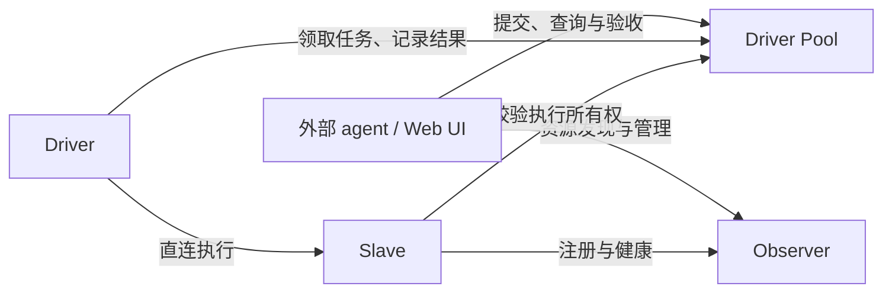

# Loom v2

**把分散的计算资源和外部服务，组织成 AI 可以发现、调用和协作使用的个人计算工作空间。**

你可以把自然语言目标交给自己的 coding agent，由它通过 GRIP 发现和调用资源，并将完整执行计划提交给发现的 Driver 资源。服务查询可以直接返回结果，字节流可以连接模型等服务；需要持久化执行的任务由独立 Driver Pool 校验、冻结计划并排队，多个 Driver 领取后直连 Slave 执行，由 Pool 保存结果、历史和验收证据。

它不仅让 AI 给出“应该怎么做”，还提供从需求、计划、执行到结果核验的运行基础。当前面向**单用户、单 Workspace**，可以在一台机器上部署，也可以连接多台执行节点。

外部 agent 通过独立 SDK 和通用 skill 使用 Loom；可选的业务经验插件把探索得到的方法保存在 agent 本地，复用前重新核验线上资源。业务经验的学习与检索由插件承担，Observer、Pool、Driver、Slave 保持通用运行职责。

按使用目的阅读：[使用已有工作空间](skills/personal-computing-space/SKILL.md) · [入口与端口](#入口与端口) · [部署 Loom](#快速开始) · [接入服务](capability_services/README.md) · [统一登录](docs/authentication.md) · [业务经验插件](plugins/loom-business-skills/README.md)。

2026-11-02 已完成独立 Driver Pool、两个 Driver 和三个 Slave 的生产部署，验证了并行执行、跨机编排与崩溃接管。部署方式见 [Driver Pool](docs/driver-pool.md)，实测范围与数据保全情况见[生产验收记录](docs/superpowers/reports/2026-11-02-driver-pool-production.md)。

2026-11-03 已部署完整计划直接入队、Run 按变化字段持久化和按引用检查资源就绪等优化；Driver 的取消检查只读取当前状态，Run 私有能力使用独立索引。验证范围和剩余性能问题见[最新复测记录](docs/superpowers/reports/2026-11-03-pool-plan-admission.md)，后续 task 性能优化由 [Issue #8](https://github.com/yzs15/personal_computing_space/issues/8) 持续跟踪。

## 能做什么

- **通过 agent 发起计算任务**：向外部 agent 描述目标、输入、约束和验收标准；它使用 GRIP 或提交完整计划，Web 界面用于查看执行状态和结果。
- **跨机器执行和组合任务**：将工作拆成多个节点，分发到不同 Slave，再汇总输出。仓库提供了多节点统计分析示例。
- **接入外部服务**：把 Kubernetes、云平台、文档服务等封装成能力包，让 agent 通过明确的接口使用它们，而不是把每个服务的逻辑写进系统核心。
- **使用任务创建的新资源**：例如通过云能力包创建 VM，再为 VM 部署 SSH 访问能力包，完成认证后在 VM 上执行命令。
- **沉淀可复用能力**：任务中生成的能力包可以显式发布，供后续任务复用；也可以直接向 Workspace 上传已有能力包，不必先创建 Run。
- **复用已验证的业务方法**：外部 agent 可用独立插件记录参数化步骤、契约和验收证据；下次按目标检索，检查当前资源后再执行。只注册一个入口 skill，经验增加不会扩充自动加载的 skill 目录。
- **查询与核验执行事实**：查看可用 Slave、能力包、资源、激活状态、任务尝试和失败原因；按内容引用取回实际结果。

仓库内已有的服务能力包如下。它们需要各自的镜像、网络、服务账号或凭据配置，不会随着 Loom 启动自动获得外部服务权限。

| 能力包（使用说明） | 当前源码版本 | 提供的能力 |
| --- | --- | --- |
| [火山方舟](capability_services/ark_http/HOW_TO_USE.md) | `ark-http/v2` | 使用 API Key 调用多模态模型、图片生成、视频任务、向量化和语音合成 |
| [Kubernetes](capability_services/kubernetes_http/HOW_TO_USE.md) | `kubernetes-http/v9` | 查询和操作声明的集群资源，管理 ClusterIP Service，通过字节流访问服务，持久化认证并恢复连接 |
| [Embedding](capability_services/embedding_http/HOW_TO_USE.md) | `embedding-http/v2` | 通过 Kubernetes 服务依赖调用嵌入模型，提供 GRIP 动作和 AutoPaper HTTP 接口 |
| [Volcano](capability_services/volcano_http/HOW_TO_USE.md) | `volcano-http/v2` | 查询队列、PodGroup 和 GPU 分配，关联对应 Kubernetes 资源 |
| [Grafana](capability_services/grafana_http/HOW_TO_USE.md) | `grafana-http/v6` | 查询仪表盘、Prometheus 指标及 GPU Arena；GPU 利用率动作需要显式或实例默认的指标映射 |
| [AutoPaper](capability_services/autopaper_http/HOW_TO_USE.md) | `autopaper-http/v4` | 统一浏览器登录后搜索论文、读取详情及查询会议和年份；搜索可通过 `auto_ingest` 选择自动抓取入库 |
| [Overleaf](capability_services/suanli_overleaf_http/HOW_TO_USE.md) | `suanli-overleaf-http/v1` | 查询项目、下载源码、检查版本、同步修改和导入新项目；在外部 agent 本地编辑与编译 |
| [Suanli Cloud](capability_services/suanlicloud_http/HOW_TO_USE.md) | `suanlicloud-http/v8` | 查询区域、节点、镜像和实例，创建及管理 VM |
| [Suanli VM SSH](capability_services/suanli_vm_ssh_http/HOW_TO_USE.md) | `suanli-vm-ssh-http/v7` | 为单台 VM 提供浏览器认证、持久自动续期、SSH 命令执行和文件传输 |
| [普通 VM SSH](capability_services/vm_ssh_http/HOW_TO_USE.md) | `vm-ssh-http/v6` | 使用挂载的 SSH 密钥访问普通 SSH VM，执行命令并上传下载文件 |
| [Outline](capability_services/outline_http/HOW_TO_USE.md) | `outline-http/v4` | 查询、检索、读取正文、创建和更新文档等受限操作 |

表中版本对应仓库内的包模板；已部署实例的版本和可用动作以 GRIP DESCRIBE 为准。
AutoPaper 搜索省略 `auto_ingest` 时沿用上游默认行为，显式传 `false` 可限定查询已有论文；搜索会保存历史，也可能新增论文，结果不确定时需先核对再决定是否重试。
Grafana 的 GPU 小时按分配时长和显存容量归一化，保留缺失数据与完整性信息；它衡量资源分配，不能直接代表实际计算量或个人使用量。

## 带来什么好处

**已有资源可以协同使用。** 本地服务器、远程 Slave、云 VM 和外部 API 不必使用相同的底层技术；能力包把它们转换成可发现、有输入输出契约的操作。

**业务扩展与系统核心分离。** 新增普通 HTTP 服务能力包时，主要工作是实现服务适配、描述能力和提供契约，不需要修改 Observer、Pool、Driver 或 Slave 主体源码。

**AI 的决策与实际执行可以分别检查。** 系统保留执行时使用的计划版本、能力包引用、输入、尝试记录和输出。模型说“完成”不等于任务成功，最终以 Run 状态、结果及验收证据为准。

**一次任务的成果可以复用。** 程序、契约和能力包不必每次重新生成；发布后的包可以被其他 Run 使用，同一个包也可以部署多个有名字的实例。业务经验插件进一步保存如何组合这些能力的方法，后续任务仍读取新结果并重新验收。

**错误更容易定位。** 能力未就绪、外部认证失败、执行失败和需要人工验收是不同状态；系统用持久化记录、幂等键和版本检查帮助对账，不把超时直接当作“没有执行”。这不等于对任意外部服务提供 exactly-once 保证。

## 系统如何运行

### 四个角色：Observer、Driver Pool、Driver、Slave



Observer 和 Pool 共用 PostgreSQL，分别写资源与任务状态；每个 Slave 保留本地 PostgreSQL 执行账本。所有服务共享 MinIO / S3 内容存储。

**Observer 管理资源，Pool 管理任务。** Observer 保存资源、Workspace 包和激活投影，接收 Slave 注册与健康报告。Pool 负责提交幂等、契约校验、计划冻结、Run／Node／Attempt 状态、执行队列、历史和结果验收；Run 内的包也随任务由 Pool 管理。公开资源通过 GRIP offers 声明各自入口，客户端显式信任运营者提供的 Pool binding。

**外部 agent 负责编排，Driver 负责执行。** GRIP 目录中的 `computing/driver` 是单一逻辑执行资源，URI 不随 Driver 进程重启变化。外部 agent 对它调用 `submit-plan`，Driver Pool 校验完整 `ClosureContract`、冻结版本并排队；Driver 领取队列项，向 Slave 派发普通任务，并在沙箱中运行 `container:python_orchestrator/1` 编排程序。它不接收 prompt、不维护会话，也不持有模型 secret。`accepting_submissions` 表示入口可接受提交，`available` 表示 Driver 租约在线；所有 Driver 离线时，Pool 仍可持久化排队。

每个 Workspace 可以有多个活跃 Driver，由 Pool 分配任务。公开提交入口仍是稳定的逻辑资源 `drivers/default`，`active_drivers` 返回在线实例数量。

每个 Run 同时只有一个有效执行所有者。所有者租约失效后，Pool 允许其他 Driver 接管，保持原 execution／Attempt 身份，并记录新的领取事件。Slave 使用本地账本重放已完成的结果；副作用结果未知时交由失败与修复流程处理。

**Slave 负责实际执行。** 它验证执行请求，在本机通过执行器或 runtime plugin 启动程序、管理能力容器，保存本地执行账本并上报结果。容器由 Slave 侧插件调用 Docker Engine 启动，不是由用户浏览器或 Driver 直接管理。

持久化任务的执行路径是 **Driver → Slave**。Driver 从注册信息取得 Slave 的执行 binding，Slave 在运行前向 Pool 验证租约、任务所有权和冻结契约。直接服务调用与字节流继续按 offer 选择服务入口、Slave 数据入口或 Observer 中转。

### 从需求到结果

1. **形成任务闭包。** 外部 agent 明确目标和验收标准，准备输入、程序与契约，选择能力包及计算资源。
2. **一次提交计划。** 外部 agent 通过 `loom-orchestration` 的 GRIP `submit-plan` 提交完整闭包；Pool 检查引用、能力绑定、契约和资源就绪条件，直接创建 `committed` Run，并在同一事务冻结版本和写入执行队列，返回 Run URI。
3. **排队执行。** Driver 领取不可变执行请求，沙箱产生的动态节点由 Pool 记录。
4. **执行和编排。** Driver 将普通任务和动态节点直接派发到 Slave；编排沙箱只执行外部 agent 提交的源码，并通过受控原语产生动态节点、资源登记和 activation。
5. **记录结果并验收。** Slave 返回输出、状态和验证证据，结果写入内容存储。Pool 更新 Run；无法自动确认的成功语义会要求人工验收，失败则保留结构化原因。
6. **复用或清理。** 用户可显式发布任务产生的能力包。外部资源的回收应纳入任务流程；关闭 Run 不意味着自动销毁云 VM。

编排程序通过受限的 `read_json`、`materialize_json`、`register_resource`、`ensure_activation`、`wait_activation`、`defer_cleanup`、`emit_node`、`result` 接口读取内容、管理资源并等待结果，不能在编排沙箱里任意访问网络。`container:python_orchestrator/1` 通过同一个 Driver 的 `submit-plan` 接受完整闭包；普通能力包的业务调用仍在 Slave 一侧完成。每个已提交版本有不可变的 `execution/plan` 资源，Run 的 `read` 返回当前计划引用、状态和结果，并可用 `include_history=true` 读取执行证据。

### 编排恢复与 action 的责任边界

**Loom 提供显式编排和恢复机制，能力包实现决定哪些内部步骤交给该机制管理。** Pool 持久保存 Run、Node、Attempt 和执行历史；Driver 接管后重新运行冻结的编排程序，通过稳定的步骤标识复用已完成节点的结果。Slave 用 Attempt 账本保存单次执行结果；Slave 重启后账本中只有“执行中”记录而没有结果时，返回 `attempt_outcome_unknown`，交由失败与修复流程处理。Run 的恢复粒度由显式登记的执行节点决定，外部副作用的业务幂等仍由能力包及上游服务保证。

例如，一个 action 内部依次调用 A、B、C，在 B 之后中断。如果这些只是普通 HTTP 或 SDK 直接调用，平台记录的是外层 action 的 Attempt，内部步骤的状态、重试和补偿由该 action 自己管理。复合 action 可以保留单个对外接口，并选择两种实现方式：

- **自行容错**：在能力包内保存步骤状态，使用业务幂等键、结果查询和补偿逻辑恢复内部流程。
- **显式复用 Loom 编排**：具备任务提交权限的能力包实现或外部调用方，通过 SDK 提交一个把 A、B、C 分别作为 Node 的编排 Run，由 Loom 管理这些节点的执行与恢复。

另行提交的 Run 当前按独立任务管理。提交方需要使用稳定的业务幂等键、保存并找回 Run 引用，以及处理等待、超时、取消和清理；平台不会自动把它与外层 Run 的生命周期关联。服务依赖授权也不自动授予提交 Run 的权限。能力包应在自己的 `HOW_TO_USE.md` 中说明采用的恢复方式和调用方责任，详见[能力包容错与复合编排](capability_services/README.md#action-的容错与复合编排)。

## 统一使用资源：GRIP

Driver、Slave、能力包、激活实例、领域资源、Plan 和 Run 都可通过稳定的 `grip://` URI 发现。使用流程是 `DESCRIBE(target)` 获取动作与 binding，再 `INVOKE(target, action, input)`。例如对 Slave 调用 `run-package`，input 引用能力包与业务输入，结果返回可查询的任务资源。激活实例直接提供自身的业务动作。

包导出的 `runtime_binding.interaction` 描述业务交互，省略时为 `request-reply`：

| 交互类型 | 调用与结果 |
| --- | --- |
| `request-reply` | 直接传入业务输入并返回业务结果，不创建 Run |
| `byte-stream` | 使用 SDK `open_stream()` 建立通道，再读写二进制数据 |

普通 JSON action 同时支持直接调用和显式任务执行，由调用方选择。探索和测试宜直接执行；需要持久记录、调度或恢复时，将 action 放入完整计划，经 Driver 的 `submit-plan` 提交并读取 Run。两条路径使用同一业务实现和校验，任务路径额外记录 Node／Attempt、输入与结果。`metadata.actions[].execution` 分别说明 direct 和 task 的可用性；缺少直调路由不阻断普通 JSON action 的任务执行。

`run-package` 使用指定 Slave 的 `default` 实例；已有命名实例通过完整计划绑定其 activation。字节流不能作为任务节点。直接调用没有固定的 30 秒服务端上限，但仍受请求 deadline 和授权有效期约束；SDK 可配置 `timeout=None` 或较长等待值。

参见[执行方式选择设计](docs/superpowers/specs/2026-11-02-action-execution-choice-design.md)及通用 skill 的[单节点计划模板](skills/personal-computing-space/references/single-action-plan.md)。

SDK 支持通过 `trusted_bindings` 限定可信入口、通过 `binding_preference` 选择已发布路由。服务授权限定目标、动作、激活修订和有效期；请求发送后失败不会自动换路重放。协议和流限制见 [GRIP 服务 binding 与字节流](docs/grip-service-bindings.md)。

所有资源引用都使用可读 GRIP 名称，包括包内 Schema、IoContract、descriptor 和程序内容。例如 `content/suanlicloud-http/schemas/instances-list-output/sha256/<摘要>`；摘要用于校验，不再单独充当整个资源名字。SDK 和资源目录使用相同 URI。

资源类型使用 `resource.mcue`，例如 `computing/vm`。`metadata.mcue_ref` 指向有版本的 MCUE 定义，
`metadata.attributes` 保存该类型 Schema 校验过的公开属性。登记资源上的 `update-attributes` 支持动态更新名称、说明、标签和硬件描述，并通过 `attributes_revision` 检查并发冲突。SDK 使用 `resources(mcue=...)` 过滤目录。

配置、SDK 示例与实例调用见 [GRIP 资源使用指南](docs/grip-resource-usage.md)。内置服务包的发布、配置与验证见 [服务包指南](capability_services/README.md)，可运行的客户端见 [GRIP 示例](examples/grip/README.md)。当前配套 SDK 为 0.14.0，计划提交、查询、修复、取消、验收和关闭均使用 GRIP；内容上传、包制作和管理界面保留相应管理接口。

凭据配置由激活实例选择：`activate-package` 的 `credential_profile` 与 `instance_config` 并列，
同包不同实例可以使用不同账号或集群。旧部署引入实例凭据时需执行 Alembic 007，见
[激活凭据升级说明](docs/activation-credentials-upgrade.md)。使用当前服务 binding 时需匹配
当前 SDK、Observer、Slave 和 `runtime-plugin/2`，见 [节点服务入口部署说明](docs/service-bindings-deployment.md)。

## 能力包、资源和实例

这三个概念分别回答不同的问题：

| 概念 | 回答的问题 | 例子 |
| --- | --- | --- |
| 能力包（Package） | 能做什么，如何调用，如何执行？ | Suanli Cloud API 包、VM SSH 包 |
| 资源（Resource） | 具体使用哪个对象，它由谁管理？ | 某个云服务资源、某一台 VM |
| 激活实例（Activation） | 这个包在什么 Slave 上，以什么配置运行，是否可用？ | `slave-a` 上名为 `vm-example` 的 VM SSH 容器 |

### 能力包提供统一接口

一个包可以导出多个能力。每个导出包含能力描述、输入输出契约（`io_contract`）、效果类别、权限声明和重放安全信息；有实现的包还包含 `body`，例如程序引用或固定 digest 的容器镜像。

输入输出契约不仅描述 JSON 字段，也可以表达成功语义及验证器。**格式正确、HTTP 成功或命令退出成功，不自动等于用户的业务目标已经达成。** 声明了成功语义但没有自动验证器时，系统可以要求人工确认。

SDK 提供紧凑资源目录、契约校验调用、持久调用预算账本和分布式 map/reduce 构造器，见 [常用工作流](skills/personal-computing-space/references/reliable-workflows.md)。预算账本只约束使用该 helper 的调用，不能替代服务端授权或独立验收。

发布者可以显式选取文件，给服务包附加与不可变镜像关联的只读诊断源码。外部 agent 无需主机 SSH 即可检查参数映射和实现；读取源码不授予修改、激活或替换生产实例的权限。修复应发布新版本并单独验证，源码摘要也不等同于镜像构建证明。流程见 [能力包诊断](skills/personal-computing-space/references/diagnostics.md)。

包还可以只有接口、没有实现：`interface + none/1`、`body=null`。这样的包用于描述资源如何使用，可以查询和发布，但不能安装到 Slave，也不会凭空赋予系统执行能力。需要系统实际调用 VM 时，仍需 VM SSH 这类带实现的包。

能力包可以通过顶层 `how_to_use_ref` 关联一份不可变的 Markdown 使用文档。使用
`ServicePackage.publish` 发布服务包时，包目录下专门的 `HOW_TO_USE.md` 会自动上传并
作为该引用；包目录中的 `README.md` 继续用于构建、部署和开发说明。通过 GRIP 调用
包资源的 `how-to-use` action 可以取得这份包专属说明以及导出的 action/schema 列表。

包的公开描述和运行时实现分离。新增已有 HTTP runtime 支持的业务包，只需交付服务镜像、manifest、descriptor 和 IO contract；如果要增加新的执行方式，则由 operator 安装相应 contract schema 和进程外 runtime plugin，并重启加载，不需要为每种业务修改核心代码。

### 资源类型、描述与访问能力

资源通过 MCUE 定义类型和公开描述属性，通过可选的 `managed_by_ref` 指向管理者。登记资源不接受包引用；访问能力由 activation 的包版本和 `target_resource_ref` 绑定决定。Observer 在读取时计算资源的就绪 `activations` 和可调用 `offers`，无需在新增或停止实例时维护资源记录。访问包升级绑定同一资源 URI 即可。已有部署的字段移除与归档见 [迁移说明](migrations/alembic/README.md#008-resource-access-bindings)。

例如，一台 VM 的 SSH 访问实例使用 VM SSH 包，而管理它的云资源通过 Suanli Cloud 实例提供管理动作：**在 VM 上执行命令**和**创建、停止或销毁 VM**是两套不同职责，不需要混在同一个包里。

VM 访问包还提供 `files.upload`、`files.download` 流式动作，复用 activation 的 SSH 认证并校验大小和 SHA-256。SDK 0.12 的 `VmFileClient` 和 `loom-vm-files` 命令行支持上传、下载及显式覆盖，见 [VM 文件传输](docs/vm-file-transfers.md)。使用前确认已部署包确实声明这些动作。

同一个包可以在同一 Slave 上创建多个命名实例，每个实例绑定自己的目标资源和配置。因此可以为每台 VM 启动一个独立的 SSH 能力容器，分别保存认证状态和 `known_hosts`，不必为每台机器复制一份包版本。

Workspace 的 `delete-resource` 用于移除领域资源登记记录。默认要求记录已报告 `state="deleted"`；`force=true` 可移除其他状态的记录。实体销毁、关联 activation 的停用和子资源处理由调用方另行完成，详见[资源记录删除](docs/grip-resource-usage.md#删除资源记录)。

### 发布、检查、激活与认证

包可以在 Run 内作为候选生成，也可以通过 `POST /api/v1/capability-packages` 直接发布到 Workspace。部署流程为：**构建并推送镜像 → 发布包 → 描述 Slave → `check-package` → 激活命名实例 → 认证 → 验证业务动作**。

Run 内创建的私有包及 activation 仅在所属 Run 上下文中可见。跨 Run 复用时，由外部 agent 显式发布到 Workspace，使用新实例名重新激活并验证，再停止原 Run 内实例；运行中连接和服务状态需要按包说明另行迁移。操作步骤见[能力作用域与共享](skills/personal-computing-space/references/capability-scope.md)。

对目标 Slave 调用 `check-package`，传入包 URI、实例名和拟使用的 `instance_config`，可只读检查节点在线状态、runtime 支持、服务签名、所需路由和依赖填写情况，返回 `ready`、`required_interactions` 和逐项 `issues`。普通 JSON action 缺少直调入口或签名时仍可激活并通过任务执行，这些问题会影响 direct 可用性；字节流缺少必需入口、签名，或配置缺少必填依赖时，激活会被拒绝。配置修复后可以重试原幂等键。

资源类型的 MCUE schema 和能力包的配置 schema 可通过 `x-loom-dependency` 标记依赖字段，并用字段说明定义业务含义。DESCRIBE 与 workspace 的 `list-resources` 动作返回实际 `metadata.dependencies`；`how-to-use` 只解释字段与填写要求。创建动作的 `attributes_mapping` 声明如何填入登记属性，发布和激活时做静态检查，登记时验证实际值。详见 [依赖设计](docs/superpowers/specs/2026-10-29-resource-dependency-metadata-design.md) 和 [MCUE 使用说明](skills/personal-computing-space/references/mcue.md)。

检查通过只代表部署配置满足条件，镜像拉取、外部认证和实际网络仍需验证。实例描述中的 `runtime_state` 是节点报告状态；容器已 ready 但存在入口问题时，公开 `state` 可为 `degraded`，任务执行仍可能可用。调用方应读取所需动作的 `execution.direct` 或 `execution.task`，确认选定执行方式的可用性。

日常能力包部署通过镜像仓库和 Observer 公开接口完成，无需节点 SSH 账号。数据监听、TLS、签名密钥、路由及 egress network 由 operator 在节点接入时统一准备。操作步骤见 [服务包指南](capability_services/README.md)。

需要外部认证的包会报告 `pending_auth`；认证和健康检查通过后才进入 `ready`，后台检查继续更新状态。服务凭据由 operator 通过受控 profile 提供，或由用户完成交互式登录，不应写入包内容、对话或任务输出。

统一认证使用实例的 `auth-start` 与 SDK 的 `loom-auth`，支持设备登录、浏览器回调和浏览器 Cookie 登录。登录助手让选定资源共用本机受保护的浏览器档案，按照实际跳转和浏览器 Cookie 规则复用 SSO 会话；**能力包无需声明 `idp`**，登录提供方变化时由浏览器跟随新的流程。各资源仍分别完成授权和凭据验证。API key、AK/SK 或 SSH 密钥由 credential profile 提供。浏览器助手运行在用户电脑上：

```text
用户浏览器 ↔ loom-auth ↔ Observer ↔ Slave ↔ 能力容器
                              认证转发不经过 Driver
```

助手提供默认关闭的“自动复用会话登录”开关，也可启动时传入 `--auto-login`。开启后依次检查选定资源，跳过已就绪实例并自动尝试复用会话；仍需扫码、授权或故障处理的实例会列在“需要处理的资源”中，显示原因和手动登录入口。手动完成一次登录后，助手继续尝试其余未完成资源。该开关用于批量登录，持续续期能力取决于各服务的认证实现。

首次登录和凭据失效后的重新认证都从同一客户端发起，重新认证无需创建新激活。助手运行在有浏览器的本机即可；认证绑定远端资源实例，其他机器上的 agent 通过公开接口调用同一已认证实例，无需复制 Cookie 或在测试机重新登录。以实例 DESCRIBE 的当前状态判断是否就绪，助手旧会话过期不等于资源认证失效。浏览器登录需安装 SDK 的 `auth` 可选依赖及 Chromium，详见 [统一认证说明](docs/authentication.md)。助手只转发固定认证消息，短期桥接 token 不进入 Run 或 ContentStore；公网部署应使用 HTTPS 保护这条链路。

## 外部 agent 的业务经验插件

[`loom-business-skills`](plugins/loom-business-skills/README.md) 是可选、独立分发的外部 agent 插件，只依赖公开的 `loom-orchestration 0.10.x` SDK。它在客户端保存业务经验，使用现有公开接口核验和调用资源，无需修改 Loom 核心、公共 SDK、协议或通用 skill。

| 组件 | 职责 |
| --- | --- |
| 通用 skill `personal-computing-space` | 发现资源、读取契约、认证、发布能力包和编排任务的通用方法 |
| 入口 skill `loom-business-memory` | 指导 agent 按当前目标检索经验、检查适用性、执行并记录验收 |
| 插件本地 CLI 与私有缓存 | 保存参数化步骤、契约引用和执行证据，处理失效、刷新及跨环境重绑定 |

入口采用**摘要检索 → 选一条经验 → 实时检查 → 按需读取步骤与契约**的流程：

1. `find '<业务目标>'` 对标题、摘要和关键词做本地文本匹配，默认最多返回 3 条摘要，上限 5 条。
2. `prepare <id>` 重新描述所选经验的全部绑定及依赖，检查包、动作、契约、修订、权限声明、认证和可用性；只有 `ready` 才返回简短步骤。契约变更、离线、受阻和需要重绑定会分别报告。
3. agent 用当前参数执行步骤并检查新结果。插件区分 `documented`、`executed`、`verified`；`accept` 记录 agent 对本次结果的验收，Run 的人工决策仍按正常任务流程处理。
4. agent 可用 `learn` 保存方法，或用 `refresh` 更新已有经验。切换环境或实例需重新发现目标并显式 `rebind`；删除经验后仍可走通用发现流程。

插件始终只注册一个[入口 SKILL.md](plugins/loom-business-skills/skills/loom-business-memory/SKILL.md)。经验默认存入 `~/.local/share/loom-business-skills/` 的 SQLite 缓存，生成的历史 `SKILL.md` 位于缓存内，不加入自动发现目录或整批注入上下文。单条经验最多 8 个步骤、合计 5,000 字符的步骤说明；大型契约通过文件按需读取。

经验保存方法和证据引用，业务参数与原始结果留在单独的私有文件中。插件由 agent 按任务调用；新的业务经验不会自动变成额外入口 skill。具体安装与命令见[插件 README](plugins/loom-business-skills/README.md)和[工作流参考](plugins/loom-business-skills/references/workflow.md)，实现取舍见[设计文档](plugins/loom-business-skills/DESIGN.md)。

## 示例：创建一台 VM 并使用它计算

这些能力可以组合成下面的工作流程：

1. 查询 Workspace 的 Slave、Suanli Cloud 包和可用激活实例。
2. 调用云包创建 VM，保存 InstanceId，并轮询状态和 IP，不能只把创建请求成功当作 VM 已就绪。
3. 在 Observer 登记 VM 资源的 MCUE 类型、公开属性和管理资源。
4. 在 Slave 上为这台 VM 激活一个有独立名字的 VM SSH 包实例，配置目标地址。
5. 通过 Observer 发起认证，用户运行本地助手并完成浏览器登录；确认实例为 `ready/authenticated`。
6. 通过 VM SSH 包执行计算，取回输出并按任务标准验收。
7. 不再需要时，通过云包终止 VM，停用对应访问实例并更新资源状态。

云 API、SSH 和 OIDC 的专用逻辑都在能力包里；外部 agent 选择并组织这些动作，Driver 执行提交的计划，Observer 负责资源管理，Pool 负责任务状态，Slave 负责容器及执行。

当前已分别验证真实云端 VM 创建、浏览器认证和 SSH 执行链路；新本地助手也已验证到 `ready/authenticated`。这些验证**不等于**“coding agent 生成单个 Run 后，从创建、等待人工认证、恢复计算到失败自动清理”的完整无人值守闭环已验收。具体测试边界见 [VM 生产验证记录](docs/superpowers/reports/2026-09-22-vm-browser-ssh-production-validation.md)（其中记录的是早期 SSH 隧道方案）。

## 快速开始

### 入口与端口

| 入口 | 职责 | 本地 Compose | 生产（2026-11-02 验收） |
| --- | --- | --- | --- |
| **Driver Pool** | 任务 Web 界面、任务 API；提交与查询 Run、结果和历史，以及 Driver 领取与上报 | [localhost:18091](http://localhost:18091/) | [9.0.16.66:8093](http://9.0.16.66:8093/) |
| **Observer** | 资源发现、包与激活管理、Slave 注册；SDK 的资源发现入口 | [localhost:18080](http://localhost:18080/) | [9.0.16.66:8080](http://9.0.16.66:8080/) |

**8093 是生产 Driver Pool 的入口。** 查看任务可以直接打开该地址；Observer 首页也会跳转到 Pool。客户端先通过 Observer 发现资源，再按 offer 中的 binding 调用 Pool 或其他服务。Driver 工作进程领取任务后直连 Slave 执行。

生产验收时运行两个 Driver 和三个 Slave；各节点地址、镜像与验收结果见[生产部署记录](docs/superpowers/reports/2026-11-02-driver-pool-production.md)。

### 本地启动

需要 Docker Engine 和 Docker Compose；本地栈提供共享的 MinIO ContentStore。先准备内部服务密钥和独立的 GRIP token；已有密钥请复用，不要在升级时覆盖：

```bash
mkdir -p secrets
if [ ! -s secrets/internal_api_secret ]; then
  (umask 077; openssl rand -hex 32 > secrets/internal_api_secret)
fi
if [ ! -s secrets/grip_token ]; then
  (umask 077; openssl rand -hex 32 > secrets/grip_token)
fi
export LOOM_GRIP_TOKEN="$(cat secrets/grip_token)"
```

检查 [Compose 配置](deploy/docker-compose.yml) 中 Observer、Pool、Driver、Slave 和 ContentStore 配置后启动：

```bash
./scripts/dev-up.sh
```

启动后打开上表中的本地 Pool 任务界面。该栈包含 Observer、Pool、一个 Driver、两个 Slave、三个独立 PostgreSQL 和 MinIO；Driver 与 Slave 不发布公共端口。要增加到两个 Driver，在同一 shell 中执行：

```bash
docker compose -f deploy/docker-compose.yml up -d --scale driver=2 driver
```

外部 agent 使用 SDK 0.14，并显式配置可信的 Pool binding，见 [SDK 连接配置](skills/personal-computing-space/references/sdk.md#driver-pool-binding)；完整流程见 [分布式编排 skill](skills/personal-computing-space/SKILL.md)。从其他机器访问时，设置 `LOOM_PUBLIC_BASE_URL` 和 `LOOM_POOL_PUBLIC_BASE_URL` 为客户端可达的地址。

未配置 GRIP token 时，GRIP 接口拒绝访问。本地 SDK 连接 HTTP 入口需显式传入 `allow_insecure_grip=True`；使用当前 shell 中的 token，或让认证客户端读取 token 文件，避免把密钥复制进示例源码。`secrets/`、`.env` 和 `production/` 已被 Git 忽略，实际凭据应保留在这些本地位置或外部密钥存储中。

默认 Compose 没有配置直接服务调用或字节流所需的数据入口与签名。使用这些入口前，按 [节点接入说明](docs/service-bindings-deployment.md) 配置，并通过 `check-package` 核验。普通 JSON action 可先通过任务执行；字节流需先满足入口条件。

### 外部 agent 的 SDK 与 skill 分发

`loom-orchestration` 是独立 Python 包，源码保留在 `loom_orchestration/`，不复制到 skill。
Observer 和 Pool 提供无需 GRIP token 的发布文件下载（以下路径以对应服务 URL 为前缀；当前源码 SDK 为 0.14.0，部署版本以下载清单为准）：

- `/downloads/personal-computing-space.zip`：完整 skill，含配套 SDK wheel。
- `/downloads/manifest.json`：技能包和 SDK 的文件名、大小、SHA-256，以及 SDK 版本。
- `/downloads/<sdk.filename>`：清单所列的独立 SDK wheel，可直接下载安装。

默认 Dockerfile 在构建镜像时，从同一份源码生成三个文件；技能、SDK 或其构建脚本
变更后，下一次构建会自动更新。同步发布 Observer 与 Pool 镜像后，两个入口提供同版本的下载内容，无需
手动复制文件到运行中的容器。文件响应要求缓存重新验证。SDK 源码或依赖发生变化时，
同时维护 `packages/loom-orchestration/pyproject.toml` 的版本号。

也可以手工构建分发文件：

```bash
python -m pip install 'setuptools>=68' 'wheel>=0.45'
python scripts/build_agent_skill.py --output dist
```

输出目录同时包含 ZIP、独立 wheel 和 `manifest.json`。本地源码运行 Observer 时，
可用 `--output loom_v2/web/downloads` 构建到默认位置，或通过
`LOOM_CLIENT_DOWNLOAD_DIR` 指向完整的发布目录。运行时不会临时构建或联网获取 SDK；
尚未构建的下载返回 404。

将 ZIP 交给外部 agent，解压后的 `assets/wheels/` 包含可安装 SDK。
技能会先检查 SDK；未安装时提示用户安装，并提供 Observer 下载地址和安装命令。
安装、升级与完整性校验见 [SDK 使用说明](skills/personal-computing-space/references/sdk.md)。

普通 Python 计算的完整发布契约见 [函数包指南](skills/personal-computing-space/references/function-packages.md)。GRIP `mode=request-reply` 表示协议交互方式，业务 action 直接返回业务结果，显式任务提交返回 Run；应读取所选 offer 的输出 Schema。使用已有命名实例时，直接调用该实例，或通过 SDK 的只读 `activation_ref()` 构造编排引用；不要把 Slave 的默认实例调用当作已认证命名实例，详见 [已有实例编排](skills/personal-computing-space/references/existing-activations.md)。
agent 只需 Python 3.12+、该 wheel 及其声明的依赖，无需 Loom 服务端源码。
此命令只构建本地交付物，不上传到包仓库；离线部署需另备依赖 wheels。

业务经验插件当前仍依赖 SDK 0.10.x，构建脚本仅接受该版本的 wheel；与 Driver Pool 配套 SDK 0.14 的集成尚未适配和验收。以下为插件现有构建命令，将路径替换为独立保存的 0.10.x wheel：

```bash
python plugins/loom-business-skills/scripts/build_plugin.py \
  --sdk-wheel /path/to/personal-computing-space/assets/wheels/loom_orchestration-0.10.0-py3-none-any.whl \
  --output dist/loom-business-skills-0.1.0.zip
```

插件 ZIP 包含 `plugin.json`、一个入口 skill、CLI 和未修改的 SDK wheel。解压后安装所附 SDK，再按宿主 agent 的插件安装流程加载目录；其他 agent 也可读取该单一入口并调用 CLI。构建和解压不会自动启用插件或修改全局 agent 配置。详细步骤见[插件安装说明](plugins/loom-business-skills/README.md#use-the-distributable)。

metadata 发布校验与发现已支持资源身份、readiness 映射和访问/清理引用检查。
终态 cleanup continuation 复用执行队列，使用预留节点及独立清理 deadline；
`cleaning_up` 结束后须检查 `outcome.cleanup`，未知副作用或失败不会声称资源已释放。
本地 fake capability 验证取消、超时和持久恢复；真实业务生命周期仍须单独验收。

### 常用查询入口

Observer 提供统一资源发现，Driver／Plan／Run 的公开任务动作绑定 Pool；Observer 保留任务请求转发入口。GRIP 动作的输入输出格式通过 DESCRIBE 返回的 Schema 资源读取；REST 管理接口可在对应实例的 `/docs` 或 `/openapi.json` 查询。

| API | 主要入口 | 用途 |
| --- | --- | --- |
| GRIP Driver `submit-plan` / `get-submission` | Pool | 提交完整计划，按业务 `idempotency_key` 查询提交、队列和结果 |
| GRIP Plan `read` | Pool | 读取 `plans/{run_id}/{closure_version}` 的不可变闭包 |
| GRIP Run `read` | Pool | 查询状态、结果和当前计划；显式分页读取执行历史 |
| GRIP Run `resubmit` / `cancel` / `resolve` / `close` | Pool | 修复计划、取消、验收或放弃、关闭终态任务 |
| `GET /api/v1/runtime` | Observer／Pool | 查询 Driver 执行运行信息 |
| `POST /.well-known/grip` | Observer／Pool，按 offer 路由 | 描述和调用资源；任务动作绑定 Pool，服务动作使用其发布的 binding |
| `GET /api/v1/capability-packages` | Observer | 包制作与完整编排所需的不可变契约、descriptor 和发布记录 |
| `GET /api/v1/content/{digest}` | Observer／Pool | 取回实际内容，核验 `X-Content-Digest` |

`client.run(uri)` 默认读取当前状态与结果。需要历史时传入 `include_history=True, history_limit=100`，再将返回的 `history_cursor` 作为下一页的 `history_after`；每页上限为 1,000 条。

Slave 在线只说明租约有效，不保证空闲容量或指定能力可用。包已发布也不保证某个实例已完成认证，任务仍须通过就绪检查。

SDK 的 `submit(request_id=...)` 参数映射到业务 `idempotency_key`，与 GRIP 消息的 `request_id` 分开。响应丢失后复用同一键和计划，或用 `submission(key)` 查询；返回 Run 只证明已接收，最终以 Run 的状态和证据为准。旧任务 REST 提交、单 Run 查询和生命周期路径已删除，本次版本使用 SDK 0.14 与配套 Observer／Pool／Slave。

### 多机部署与安全边界

复制 [deployment.example.toml](deploy/deployment.example.toml)，填写各角色机器、端口和密钥文件配置，再执行：

```bash
python scripts/deploy_cluster.py --config deploy/deployment.example.toml --dry-run
python scripts/deploy_cluster.py --config deploy/deployment.example.toml
```

远程部署在 `[cluster]` 配置 `grip_authority`、`public_base_url`、`grip_token_file`；token 文件作为 Observer 和 Pool 的 secret 挂载，dry-run 会隐藏内容。Observer 部署项目包含独立 Pool 服务，通过 Observer 机器配置的 `pool_port` 设置公开端口，默认 8091；本次生产配置使用 8093。Driver 与 Slave 的 `LOOM_POOL_URL` 必须可达，Slave 注册的执行 endpoint 也必须能被 Driver 直接访问。

服务直连和中转还需配置 `[cluster.service_access]` 的签名、验证公钥及 data/upstream bindings，并在对应 Slave 设置 `grip_data_port`。部署清单会拒绝已声明路由却缺少数据监听或签名密钥的配置；远端 TLS 和连通性仍需实际验证。配置模板与步骤见 [节点服务入口部署说明](docs/service-bindings-deployment.md)。

`[driver]` 仅配置 `workspace_path`。Driver 执行已提交的任务，无需模型服务、Codex/Volcengine 配置或模型 API key；旧的模型配置字段会被拒绝。

目标机需要 Docker/Compose，部署账号需要相应 SSH 和 Docker 权限。这是 **operator 的部署权限**，不是用户使用工作空间或认证外部服务所需的权限。Observer／Pool、Driver、Slave 和 MinIO 也可以用 `scripts/deploy_*.py` 分别更新。

从旧版本升级到 Driver Pool 时，先备份并停止旧写入服务，再协调更新 Observer、Pool、Driver、Slave 与 SDK，执行 `010_driver_pool` 迁移。原有 Run 历史按序迁入追加事件表；升级与回退步骤见 [Driver Pool 部署说明](docs/driver-pool.md#升级与恢复)。

当前系统不是多租户公共云平台。公开 API 的访问范围需要部署方通过网络、反向代理及访问控制保护；内部服务使用独立 token。开发 Compose 的数据库和 MinIO 默认密码不能直接用于公网生产环境。

Docker socket 和 runtime plugin 属于受信任的运维边界；容器隔离不应被视作运行任意不可信代码的完整安全保证。访问外部服务需要 operator 配置受控 egress 网络和凭据。数据库、内容存储、Driver 状态及能力容器的持久状态需要分别备份。

## 开发与测试

Python 开发环境要求 3.12 或更新版本：

```bash
python -m venv .venv
.venv/bin/pip install -e '.[test]'
.venv/bin/python -m pytest tests -q
```

业务经验插件有独立测试目录，可在上述环境中单独运行：

```bash
.venv/bin/python -m pytest plugins/loom-business-skills/tests -q
```

部分测试需要可用的 Docker runtime，集成和 E2E 测试还可能需要运行中的数据库或 Compose 栈。`./scripts/test-e2e.sh` 仅检查已启动栈的基础健康和节点发现，不代表完整任务验收。HTTP 能力包和多节点执行可分别参考 `scripts/accept-container-http.py`、`tests/e2e/`。

外部 agent 的真实使用验收见 [仅凭 skill 的 Codex 验证流程](docs/validation/skill-only-codex.md)：在隔离环境中只提供发布版 skill、任务和连接认证配置，禁止主机 SSH 与项目 checkout；可以通过公开接口读取当前能力包主动发布的诊断源码。按资源发现、远端计算、服务调用及生命周期分别核验。[初轮报告](docs/validation/2026-10-27-skill-only-live.md) 保留原始失败，[修复后完整用例复测](docs/validation/2026-10-27-skill-only-rerun.md) 记录各轮独立结果、认证状态及当前部署限制。

[六任务基线复测](docs/validation/2026-10-27-skill-only-expanded.md) 保留资源漏发现、参数与编排错误、超预算误报通过和凭据输出等问题。[修复与源码诊断复测](docs/validation/2026-10-28-skill-only-repair.md) 记录 Outline 正文修复、Observer 并发状态修复、SDK 0.9、凭据代理及真实任务结果。业务调用成功与完整验收分开统计，目前仍不能宣称仅凭 skill 可以稳定独立交付。

GRIP Driver 与原生任务的[自动化验证](docs/superpowers/reports/2026-10-30-grip-native-tasks-validation.md)和[生产部署验收](docs/superpowers/reports/2026-10-30-grip-native-tasks-production.md)覆盖完整计划、普通函数任务、幂等找回、冻结计划与 Run 生命周期；各路径的测试环境和限制分别记录。

Driver Pool 的[生产验收](docs/superpowers/reports/2026-11-02-driver-pool-production.md)覆盖三个 Slave 的直连执行、双 Driver 离线排队与并行领取、真实三节点 Docker 编排、历史分页及两个方向的 Driver 崩溃接管。接管保持同一 execution／Attempt，测试副作用只执行一次，历史记录接管所有者。原有 619 个 Run、103 个包、113 个激活及 11 个待决定状态已核对保全；Pool、数据库和内容存储仍为当前单实例部署。

业务经验插件的[验证记录](plugins/loom-business-skills/VALIDATION.md)包含 42 项自动化测试、独立安装包检查、1,000 条经验的上下文边界测试，以及 AutoPaper 与 Overleaf 的真实只读调用和新进程复用。当前尚未完成独立模型会话的冷启动/复用 A/B，未测得模型 token 节省或跨模型成功率；既有通用 skill 冷启动验收保持独立。

## 代码与文档导航

- `loom_v2/observer/`：资源目录、Workspace 包与激活管理、Slave 注册，以及任务入口转发。
- `loom_v2/pool/`：任务 API、准入校验、不可变计划、Run／Node／Attempt 状态、队列、历史和结果验收。
- `loom_v2/driver/`：冻结计划的队列领取、Slave 直连派发、沙箱执行与动态编排运行时。
- `loom_v2/slave/`：执行请求、执行账本和 runtime plugin 宿主。
- `loom_v2/contracts/`：各角色共享的任务、资源、能力包及协议契约。
- `runtime_plugins/`、`package_contracts/`：可安装运行时及其 contract schema。
- `capability_services/`：业务能力服务、IO contract 和随包提供的客户端；两个 SSH 包复用的四个模块见[公共实现说明](capability_services/README.md#ssh-公共实现)。
- `loom_orchestration/`、`packages/loom-orchestration/`：独立 SDK、GRIP 客户端、认证助手与分发配置。
- `skills/personal-computing-space/`：外部 agent 使用指南及 SDK、认证、服务 binding 参考。
- [`plugins/loom-business-skills/`](plugins/loom-business-skills/README.md)：独立的业务经验插件、单一入口 skill、私有缓存 CLI 和专项测试。
- `loom_v2/content_store.py`、`loom_v2/db/`、`migrations/`：内容存储、数据库模型和 Alembic 迁移。
- `deploy/`、`scripts/`、`tests/`：部署配置、运维脚本与验证。

进一步阅读：[能力包模型](docs/capability-package-model.md)、[Slave 发现 API](docs/observer-slaves-api.md)、[Driver Pool 与直连执行](docs/driver-pool.md)、[设计规范](docs/superpowers/spec-design-guidance.md)、[竞品对比与 Loom 的特色](docs/competitive-analysis.md)、[Loom 对外讲稿](docs/loom-pitch.md)。历史 spec 记录各阶段决策，具体支持范围以当前实现和验证记录为准。[能力包部署前检查验证记录](docs/superpowers/reports/2026-10-26-package-deployment-preflight-validation.md) 说明了对应功能的本地回归范围与生产升级边界。
