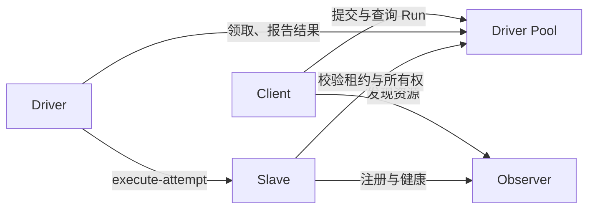

# Driver Pool 与 Slave 直连

Observer 管理资源目录、workspace 包、激活与 Slave 注册。Driver Pool 是任务状态的唯一写入方，负责提交幂等、校验、计划冻结、Run/Node/Attempt、执行队列、结果验收和历史。多个 Driver 各自领取 Run，使用 Slave 注册时提供的可信执行 binding 直接调用 Slave。

外部提交的完整计划经校验后，直接创建 `committed` Run，并在同一事务写入执行队列；不经过交互式规划的 `thinking` 状态。修复重提也直接冻结新版本。冻结版本、摘要和提交幂等仍保留，确保恢复与重试使用已经接受的计划。交互式构建草稿时仍使用 `thinking`。



任务 Web 界面由 Pool 提供；配置公开 Pool 地址后，Observer 首页跳转到该界面，使浏览器调用保持同源。历史面板提供前后翻页。Observer 的任务 API 入口转发到 Pool。执行请求与结果不再通过 Observer 中继。Driver/Run/Plan 的公开 GRIP offers 绑定 Pool；Slave 的 `execute-attempt` 是内部动作，检查内部凭据、Driver 租约、Run 所有权、Attempt、执行 epoch、目标和冻结契约。Slave 本地还检查 activation revision。

首版复用现有 PostgreSQL 和 ContentStore。Observer 可以查询共享数据库中的任务摘要，目录不会解码 Run 历史；Pool 通过 Observer 修改 workspace 资源。Run-bound 包随 Run 由 Pool 管理。数据库仍使用现有 `observer` migration role，不需要搬库。

Run 级包和 activation 只在所属 Run 的上下文中可见。`run_capability_states` 按 `run_id` 保存当前包与激活投影，并随 Run 修改在同一事务中更新；包与激活没有变化时不重写投影。Slave 目录刷新只读取 Slave 注册信息和 workspace 包表。全局目录不会扫描 Run 表，也不会把其他 Run 的私有包或 activation 合并为 Slave 的共享能力。

跨 Run 共享由外部 agent 显式完成：将包发布到 workspace，在 workspace 重新激活并验证，再停止原 Run 内的实例。发布接口将派生版本保存到 `workspace_capability_packages`，不会把旧 activation 自动改成共享实例。迁移步骤与接口见[通用 skill 的作用域说明](../skills/personal-computing-space/references/capability-scope.md)。

## 启动与配置

本地 Compose 已包含 `pool` 服务，默认公开端口为 18091；Observer 为 18080。

```sh
docker compose -f deploy/docker-compose.yml up -d --build --scale driver=2
```

| 设置 | 作用 |
| --- | --- |
| `LOOM_POOL_URL` | Observer、Driver、Slave 使用的 Pool 内部地址，本地为 `http://pool:8091` |
| `LOOM_POOL_PUBLIC_BASE_URL` | 外部客户端可达的 Pool 地址，用于公开 offers |
| `LOOM_OBSERVER_URL` | Pool 使用的资源控制入口 |
| `LOOM_DATABASE_URL` | Pool 与 Observer 使用同一个数据库 |
| `LOOM_INTERNAL_API_SECRET` | 服务间凭据，四类服务保持一致 |
| `LOOM_DRIVER_EXECUTION_CONCURRENCY` | 每个 Driver 同时执行的独立 Run 上限，默认 4，范围 1–64；有空位才领取下一个 Run |
| `LOOM_POOL_SUBMISSION_CONCURRENCY` | 每个 Pool 进程同时处理 `submit-plan` 的上限，默认 4，范围 1–64；等待者不占数据库连接 |
| `LOOM_GRIP_AUTHORITY` / `LOOM_GRIP_TOKEN` | Observer 与 Pool 使用相同公开身份及凭据配置 |

默认 Driver ID 根据容器 hostname 区分；手工部署时为每个 Driver 设置不同 `LOOM_AGENT_ID`。同一 ID 的新实例会替换旧租约，其他 Driver 保持活动。部署生成器在 Observer 所在机器增加独立 Pool 服务与 `pool_port`（默认 8091），Driver ID 使用机器名。

发布地址必须对调用方可达。SDK 0.13 显式信任运营者提供的 Pool binding，见 [SDK 配置](../skills/personal-computing-space/references/sdk.md#driver-pool-binding)。Slave 的注册 endpoint 则必须能被 Driver 直接访问。

## 升级与恢复

升级前停止旧 Driver 和旧 Observer，备份现有 PostgreSQL，再使用同版本代码启动 Observer、Pool、Slave 和 Driver。服务启动自动运行 Alembic `010_driver_pool`：取消 workspace 单 Driver 限制，将已有 Run 事件按原序号复制到追加表 `run_events`。旧 `runs.events` 列冻结保留；状态与新增事件同事务提交。回退前停止新服务；downgrade 会将完整历史合并回旧列、使 Driver 租约过期，并恢复单 Driver 约束。

`011_run_capability_scope` 创建 Run 能力状态索引，并把历史上已经发布、但仍嵌在 Run 内的共享包及其 activation 写入 workspace 表。迁移保留 Run 快照与历史；私有候选包继续归原 Run。回退该修订只删除索引表，已显式发布的 workspace 包保留。

领取采用 PostgreSQL 行锁与 `SKIP LOCKED`，不同 Run 可并行。Pool 只恢复所有者租约失效的任务，保持原 execution/Attempt 身份；有效所有者的任务不被其他 Driver 接管。Slave 在执行副作用前写入 Attempt 账本，完成结果可重放；进程重启后只有“执行中”记录而无结果时返回 `attempt_outcome_unknown`，由任务失败/修复流程处理，避免盲目重复副作用。

领取到启动只复核一次就绪状态；创建 Attempt、更新执行所有权和 Run 状态合并保存。就绪检查读取 Slave 注册信息，并按计划引用定向读取包；编排包只检查声明的节点包，不刷新整个 workspace 的包目录。各状态操作明确指定持久化字段，仅更新变化的列并追加事件；普通状态变更不重新序列化计划快照和能力列表。

完整计划入队与增量写入已于 2026-11-03 部署，性能变化与剩余热点见[生产复测记录](superpowers/reports/2026-11-03-pool-plan-admission.md)。

独立 Run 的并发上限与编排内部的 `max_live_nodes` 分别生效。取消或超时只终止对应 Run 的执行；关闭 Driver 会停止本地执行，由 Pool 按租约恢复。Pool 写入路径先锁 Run 再锁执行请求；`get-submission` 通过一次无写锁查询读取一致快照。事务内的资源和租约读取复用当前连接，不能提前提交外层事务。能力包查询按具体引用定位；校验缓存有容量上限，按完整持久化内容区分条目，并返回独立副本，发布状态与 activation 仍从数据库刷新。

Driver 等待执行时使用内部 `run.status` 检查取消：一次按 Driver 身份读取租约字段，一次按 Run ID 读取当前状态及 workspace 归属。查询不读取完整 Run、计划、结果或事件历史，不获取 Run 写锁，也不生成命令回执。相同请求 ID 再次查询仍返回最新状态。`run.get` 继续用于确实需要完整执行上下文的操作。

上述作用域与状态查询优化已完成生产部署，验证与性能变化见[复测记录](superpowers/reports/2026-11-02-driver-pool-scoped-queries.md)。

`client.run(uri)` 默认只取状态。历史读取使用 `include_history=True`，通过 `history_after` 和 `history_limit`（1–1000，默认 100）分页；下一页传入返回的 `history_cursor`，空事件页表示读到当前末尾。

2026-11-02 已完成生产部署和多机验收，详见[生产验收记录](superpowers/reports/2026-11-02-driver-pool-production.md)。升级涉及服务契约变更，Observer、Pool、Driver、Slave 与 SDK 应一起更新。
