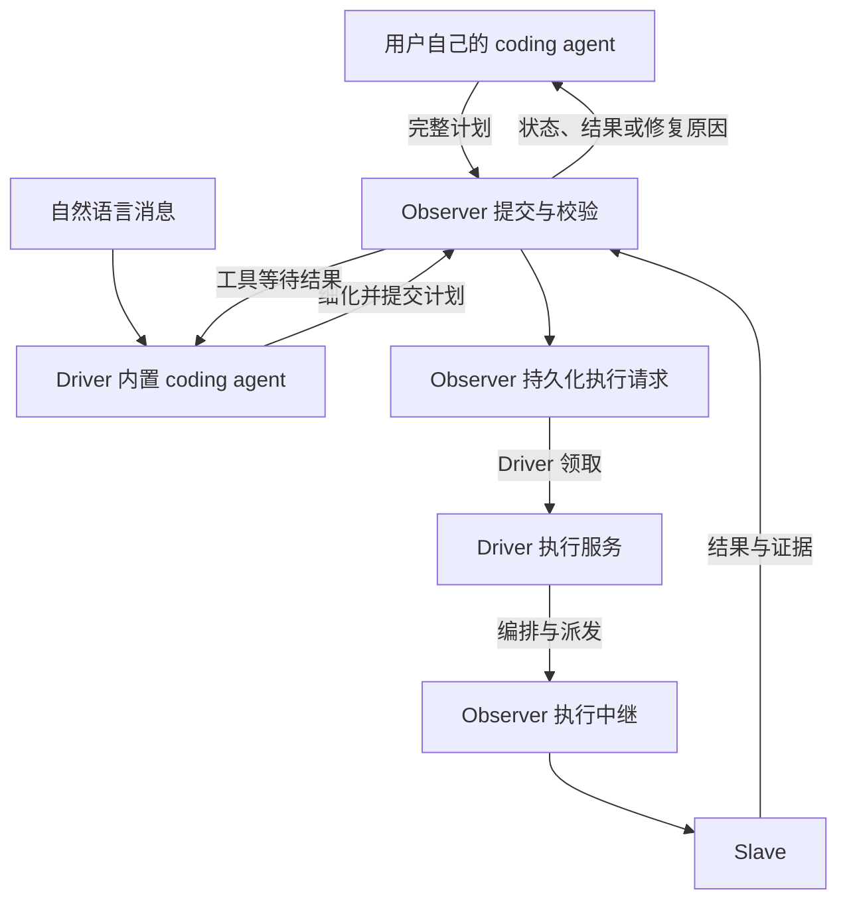

# 外部 Agent 规划与 Driver 独立执行（历史版本）

**日期：** 2026-10-09  
**状态：** 已被 2026-10-11 spec 完全取代，仅保留历史背景
**适用规范：** [Spec 设计原则](../spec-design-guidance.md)

**状态说明：** 本文的内置 planner、`/api/v1/messages`、conversation projection、DriverMCP 规划工具和“两条规划路径”均已由 [外部 Agent 编排与 Driver 执行专用化](2026-10-11-external-orchestration-execution-only-design.md)取代；本文不再作为实现依据。执行队列、lease fencing、Node/Attempt 恢复和无模型执行的约束已整合到新 spec。

## 1. 目标与核心决策

用户可以用自己的 coding agent 准备完整任务计划，经 Observer 提交，由 Driver 执行。提交、校验、排队、执行和结果查询均不要求启动系统内置 coding agent，也不要求模型服务可用。自然语言消息入口继续提供内置规划服务。

规划者负责决定做什么、提供哪些程序和输入、使用哪些能力、如何验收。Observer 管理权威状态和校验，Driver 接管执行，Slave 完成具体计算。内置 coding agent 是一种规划来源，不再是执行的必经入口。

本设计不要求向后兼容。直接操作 Run 草稿和执行状态的旧公共接口在本次重构中删除，不增加兼容转发层。内部规划工具可以继续逐步细化草稿，但所有执行都进入同一条持久化执行队列。

复用现有 `ClosureContract`、`TaskClosure`、能力包、ContentStore、readiness、Run 状态机、Driver lease、Node/Attempt 和编排运行时。新增完整计划提交协议及执行请求记录，不新增计划 DSL、消息中间件或通用调度框架。

## 2. 当前问题与重构边界

当前实现有三个相关事实：

1. `Observer.app` 的公开 Run open/patch/commit/start 路由直接调用 repository；`ObserverRepository.start()` 只记录执行状态和 Attempt，不负责启动 Driver 执行。
2. `DriverMCP.call("loom_start_run")` 在 `run.start` 后调用注入的 `run_executor`。实际派发因此依附于 coding-agent 工具调用。
3. `DriverService` 同时持有 provider、turn coordinator、执行 task、WorkerSession 和编排运行时。执行方法还接收 `prompt`，但实际输入已从 `NodeInputBinding` 的内容引用读取，不需要 prompt。

当前 skill 将这一实现路径规定为唯一外部使用方式，没有独立的“完整计划提交后执行”契约。只放开旧接口会留下“Run 显示 running，但没有执行者”的问题。

本次将执行生命周期从模型 turn 中分离，补齐可靠交接。既有 `Driver → Observer → Slave` 中继拓扑、能力容器认证流程和最终结果校验继续使用；不改成外部 agent 直连 Driver 或 Slave。

## 3. 角色与流程



| 角色 | 负责的内容 |
| --- | --- |
| 外部或内置规划者 | 程序、输入、能力选择、计算绑定、预算、约束、成功标准及语义修复 |
| Observer | 身份和 workspace 绑定、计划校验、不可变版本、执行请求、Run/Node/Attempt 状态、结果验证 |
| Driver 执行服务 | 领取请求、执行已提交程序、按约定调度、对账与恢复、上报结果 |
| Slave | 能力运行、实例和执行准入、实际计算、执行账本与结果报告 |

计划来源记为 `external` 或 `builtin`，由入口确定，仅用于流程归属和展示，不作为信任等级。两种来源经过相同的任务校验与执行准入。

外部任务不创建 Codex thread、模型 turn 或伪造的用户消息。可关联 conversation 供展示，但该关联不允许内置 agent 自动接管该任务的规划或修复。

这里的 `conversation_ref` 有两个需要分开的含义：

- **Observer conversation projection：** 外部 agent 可以在提交时提供稳定的 `conversation_ref`。Observer 将 Run、提交请求、状态事件和结果挂到这个引用下，`GET /api/v1/conversations/{conversation_ref}` 可以查询这组任务。该投影不要求存在消息 receipt，也不要求存在 Driver thread。
- **Driver/Codex thread：** 只有内置自然语言规划入口才创建和维护 `driver_threads`。外部 agent 提供的 `conversation_ref` 不会触发 thread 创建、模型 turn、消息转发或内置 agent 恢复。

因此，外部 agent 可以自己拥有对话上下文，同时让 Observer 保留可查询的任务关联。Observer 保存的是引用和执行投影，不接管外部 agent 的消息历史。外部 agent 未提供 `conversation_ref` 时，提交仍可执行，调用方使用 `GET /api/v1/run-submissions/{request_id}` 和 `GET /api/v1/runs/{run_id}` 查询，不生成匿名 conversation。

## 4. 对外计划提交协议

### 4.1 准备材料

外部 agent 先通过公开接口读取 Slave、能力包、资源和激活状态，再准备计划：

1. 使用 `POST /api/v1/content` 上传输入、程序、schema、IoContract 和 descriptor，使用服务器返回的不可变引用。
2. 需要新能力包时，使用现有 `POST /api/v1/capability-packages` 注册完整 manifest；该操作仍明确表示发布为 workspace 可复用包，不因提交任务偷偷改变包的作用域。
3. 将精确能力包引用、输入引用和计算绑定写入 `TaskClosure`，补齐 `ClosureContract` 的预算、约束和验收条件。

外部提交使用当前 workspace 可见的已发布包；内置规划者仍可使用本 Run 的候选包。已有包作用域规则不因规划来源改变。计划必须自包含，不依赖外部 agent 的本地路径、对话上下文或隐含的 prompt 输入。

### 4.2 首次提交

新增：

```http
POST /api/v1/run-submissions
Content-Type: application/json
```

请求结构如下；`plan` 中的 `body` 按现有 `TaskClosure` schema 提供完整内容，此处不展开该模型：

```text
{
  request_id: string,
  conversation_ref?: string,
  plan: {
    closure_id: string,
    goal: string,
    required_success_criteria: [...],
    allowed_effects: [...],
    resource_budget: {...},
    recovery_policy: {...},
    result_expectations: [...],
    declared_constraints: [...],
    body: TaskClosure
  }
}
```

`plan` 是 `ClosureContract` 的可提交字段投影，不建立第二套任务模型。`user_id`、`workspace_id`、`origin_conversation_ref` 由 Observer 根据部署上下文及请求关联填充。`closure_id` 是调用方的逻辑标识，不作为幂等键；它与 `body.closure_id` 必须一致。

未提供 conversation 关联时，Observer 为现有 `task_ref` 生成提交专属标识，不建立模型会话。外部任务的运行输入全部来自 `plan`，该标识只用于关联记录。

新请求模型拒绝未知字段。调用方不能提交 `run_id`、状态、execution/attempt 标识、版本摘要、结果或执行证据。上传时得到的内容和包摘要仍须原样携带，不能由调用方替换成自称可信的摘要。

Observer 完成校验后，在同一数据库事务中创建 Run、保存完整已提交契约和不可变版本、插入执行请求。返回 HTTP `202`：

```json
{
  "request_id": "request-example",
  "run_id": "run-example",
  "closure_version": "committed-example",
  "snapshot_digest": "<server-owned digest>",
  "state": "committed",
  "execution_request_state": "queued"
}
```

`202` 表示计划已持久化并排队。Driver 领取并完成启动准入后才进入 `running`；排队期间没有 execution/attempt。首次提交不向调用方暴露中间的 `opened/thinking` 草稿状态。

没有在线 Driver 时仍可接受通过校验的计划并排队。Slave、能力和输入方面的既有 readiness 阻塞仍返回明确错误，不把不完整计划放入队列等待模型补齐。

### 4.3 查询、幂等与校验反馈

新增 `GET /api/v1/run-submissions/{request_id}`，用于提交响应丢失后找回同一 Run。请求标识按当前 workspace 隔离。既有 `GET /api/v1/runs/{run_id}` 返回完整执行状态、outcome、动态节点和证据，并增加当前执行请求投影。

当提交带有 `conversation_ref` 时，Observer conversation projection 至少包含该提交的 `request_id`、来源 `external`、Run 摘要、执行请求状态和事件；它不把外部计划伪装成 `messages` 中由用户发送的自然语言消息。自然语言 receipt 和 Codex assistant 消息仍只由 `/api/v1/messages` 产生。`GET /api/v1/conversations` 的 `run_count` 和状态统计同时计入这类外部 Run。

执行提交的幂等键是 `(workspace_id, request_id)`，与自然语言消息 receipt 分开：

- 相同标识、相同规范化内容返回同一提交和 Run，不再次创建版本或执行队列项。
- 相同标识、不同内容返回 `409 request_id_reused`。Observer 读取已保存的规范化提交内容直接比较；内容包括 plan、conversation 关联，以及修复请求的目标 Run 和基准版本。
- 比较使用现有 canonical JSON 规则，JSON 字段顺序不影响幂等；不新增 `request_digest` 字段，也不为执行队列项重复计算摘要。
- 被校验拒绝的请求不创建 Run 或占用成功提交记录。调用方修改计划后使用新的 request_id；传输结果不确定时使用原 request_id 和原始内容重试。
- 数据库唯一约束承担多请求并发下的幂等保证，内存 task 或字典不能作为权威。

结构错误返回 `422`。引用、作用域、schema、计算绑定、约束、预算或编排 preflight 不满足要求时，返回 `409 readiness_blocked`，携带已有结构化 blockers；能定位到计划字段的错误附带字段路径。不会自动调用内置 agent 修复。

初次提交、内部提交和真正启动都复用同一组校验规则。不可变引用和程序校验可复用已验证结果，Slave 租约、激活 revision 等运行时事实在领取后重新检查。提交校验不以 Observer 宿主机是否安装 Docker 判断 Driver 的执行能力；编排运行时检查由 Driver 执行。

### 4.4 错误回传协议

外部 agent 不依赖 Driver 的进程连接，也不接收 Driver 的原始异常。错误通过两条稳定的 Observer 查询路径回传：

```text
GET /api/v1/run-submissions/{request_id}
GET /api/v1/runs/{run_id}
```

提交响应中的 `request_id` 和 `run_id` 是后续查询的稳定关联。外部 agent 自己的对话框和上下文仍由外部 agent 管理，Observer 不向该对话框注入消息。v1 不增加 webhook 或外部 agent 回调；调用方按有界间隔轮询提交投影，获得终态后停止轮询。

如果提交时提供了 `conversation_ref`，调用方可以使用现有的 conversation 投影查看关联任务；SSE stream 只是已有的可选展示能力，不属于本次执行协议，也不作为外部 agent 获得错误的必要路径。它不是外部 agent 的原生对话流，不会创建 Driver thread、触发内置 agent 或替代 Run 查询。未提供 `conversation_ref` 时没有这层关联，直接使用 `request_id/run_id` 查询即可。

阶段与回传方式如下：

| 阶段 | 外部 agent 看到的结果 |
| --- | --- |
| HTTP 信封或字段错误 | 提交接口同步返回 `422`，包含字段路径和结构化错误 |
| 引用、作用域、schema、预算或静态 readiness 不满足 | 提交接口同步返回 `409 readiness_blocked`，包含 `blockers`；不创建 Run 或队列项 |
| 已接受、等待 Driver | 提交查询返回 `execution_request_state=queued`，无错误；Driver 离线不是任务失败 |
| Driver 领取时资源或激活状态变化 | Run 进入 `awaiting_decision`，`outcome.decision=repair`，包含 `terminal_error`/`blockers`；队列项 settled |
| Driver/Slave 执行失败 | Run 进入 `failed` 或 `awaiting_decision(repair)`，包含结构化 `terminal_error`、Attempt/Node 证据和清理结果 |
| Observer 验证结果失败 | Run 进入 `awaiting_decision(repair)`，包含验证错误、失败字段路径和验证 evidence；不接受 Slave 自报的成功 |
| 用户或外部 agent 取消 | Run 进入 `cancelled`，outcome 记录取消原因和仍不确定的外部副作用 |
| 结果需要人工验收 | Run 进入 `awaiting_decision(attestation)`；调用方读取结果引用和证据，再由有权用户调用 `resolve` |

异步错误的最小结构使用现有 Run outcome 约定：

```json
{
  "disposition": "failed | awaiting_decision | cancelled",
  "decision": "repair | attestation | null",
  "terminal_error": {"code": "...", "message": "...", "details": {}},
  "validation_evidence": [],
  "resource_ref": null,
  "execution_id": "...",
  "execution_epoch": 1
}
```

`message` 面向调用方，不能包含 secret、内部 endpoint 或完整堆栈；可诊断字段放在受限的 `details` 中。外部 agent 根据 `decision=repair` 自己生成新计划并使用新的 `request_id` 调用 resubmit；系统不把错误消息自动送回另一个 planner，也不把 Driver 异常伪装成成功。

## 5. 持久化执行请求与原子交接

### 5.1 执行队列项（Execution Request）

这里的“执行请求”是 Observer 数据库中的内部**执行队列项**，不是用户发来的 HTTP 请求，也不是自然语言入口的 `message_receipts`。计划提交成功后，Observer 创建一条队列项；Driver 领取的是这条队列项。新增 Observer 所有的 `run_execution_requests` 表，作为可领取的执行记录，不复用自然语言 `message_receipts`。

术语固定如下：`POST /api/v1/run-submissions` 是**提交 HTTP 请求**；`run_execution_requests` 中的一行是**执行队列项**；Driver 调用 `execution.claim_next` 是**领取命令**。下文提到“队列项”时均指数据库记录，提到“提交请求”或“命令请求”时才指 HTTP/RPC 调用。队列项的状态 `queued → claimed → settled` 分别表示等待 Driver、已分配执行 owner、已不再调度。

| 字段 | 用途 |
| --- | --- |
| `workspace_id, request_id` | 复合主键，提交幂等 |
| `run_id, closure_version` | 关联 Run 和此次不可变版本；组合唯一 |
| `source, conversation_ref` | 规划来源及可选展示关联 |
| `closure_contract` | 此次完整契约的不可变快照，包括预算与成功标准 |
| `state` | `queued / claimed / recovering / settled` |
| `driver_id, driver_instance_id, driver_epoch` | 当前 Driver 进程注册实例及其租约世代；未领取时为空。`driver_instance_id` 不是 VM 或业务资源实例，而是本次 Driver 进程注册生成的身份。这里的 owner 只表示执行租约持有者，不表示用户或规划者 |
| `execution_id, execution_epoch` | 启动后由 Observer 分配；恢复时保留关联历史 |
| `outcome` | 本请求 settled 时保存的最终 outcome，后续修复不覆盖 |
| `started_at, deadline_at` | 首次开始时间及执行截止时间 |
| `created_at, updated_at` | 查询和调度顺序 |

`snapshot_digest` 继续描述 `TaskClosure`，不把它误当作整个 `ClosureContract` 的摘要。它用于 closure 版本和 commit 校验，不承担整个提交的幂等身份。执行队列项保存的契约与版本一起冻结，Driver 的预算及验收不能读取后来改写的契约。

`settled` 表示本次执行请求不再调度，Run 的 `completed/failed/cancelled/awaiting_decision` 和 outcome 才表示业务结果。修复创建新请求；旧请求及对应契约保留可查询历史。

提交查询返回请求自己的版本、状态及历史 outcome，同时提供当前 Run 的关联，不把修复后的当前结果冒充旧请求的结果。取消或用户 resolve 后，Run 当前投影可以继续变化，已 settled 请求保留该次执行交回的结果。

同一 Run 最多有一个未 settled 的执行请求，由数据库部分唯一索引保证。初版沿用单活跃 Driver，并使用独立于模型 turn 的单个 Run 执行通道；Run 内并行仍由现有节点预算控制，不增加新的集群调度系统。

### 5.2 Driver 主动领取

Driver 启动后运行独立执行循环，通过现有受 lease 保护的内部 command 通道调用 `execution.claim_next`。Observer 按创建顺序选择可领取的执行队列项，返回不可变执行上下文；没有任务返回空结果。使用现有 asyncio 和有界轮询即可。

Observer 的领取操作必须在同一事务中完成：

1. 校验当前 Driver lease/epoch，并锁定待领取队列项和 Run。
2. 校验队列项仍有效、Run 未取消、版本未被替换。
3. 完成启动时的校验；通过后分配 execution/attempt、记录 owner，并将 Run 转为 `running`、队列项转为 `claimed`。
4. 保存事件和该领取命令的幂等返回值。

以上步骤描述首次领取。`recovering` 请求同样通过 `execution.claim_next` 取得新 owner，但先返回已有 execution/attempt 上下文进行第 7.4 节的对账，不能按新任务立即分配并派发第二个 Attempt。

每次领取调用有独立命令 request_id；响应不确定时重试同一次调用，必须得到同一领取结果。收到确定响应后下一次扫描使用新标识，不能因缓存空响应而永远看不到后续任务。

启动时资源发生变化、校验未通过，则请求 settled，Run 进入 `awaiting_decision(repair)`，保留 blockers；不在后台修改资源绑定。状态机增加这一明确的 `committed → awaiting_decision` 路径。

内容读取和编排静态分析可在持久化事务外进行，提交事务内必须复核版本和相关数据库状态，避免跨网络长时间持有行锁。新增原子操作要重构相应 repository 写入边界，不能串联多个各自提交事务的旧 `open/commit/start` 方法假装原子。

### 5.3 结果落盘

Driver 继续通过现有执行中继、Node/Attempt 协议完成任务。Observer 落盘 terminal outcome 时，在同一事务中将对应请求 settled。结果接受仍校验当前 execution、attempt、Driver owner 和 epoch。

Driver 的进程内 task 表只用于运行管理；任务归属和是否已结算以 Observer 数据库为准。HTTP 断开、外部 agent 退出、模型工具等待被取消，都不自动取消已经提交的执行请求。

## 6. Driver 内部重构

将 `DriverService` 的实际执行、WorkerSession 管理、执行 task 和编排运行时移入一个具体的 `DriverExecutionService`。它依赖控制客户端、ContentStore、现有 runtime 和 settings，不依赖 coding-agent provider、TurnContext 或 prompt，不增加执行器基类体系。

两条规划路径共用同一执行队列：

- **外部计划：** 公开提交接口直接完成校验、commit 和 enqueue，由执行服务领取。
- **内置计划：** 保留内部 open/patch/readiness/commit 工具；`loom_start_run` 改为对已提交版本 enqueue，然后等待 Observer 的最终投影，不直接派发。其最终工具结果仍包含 outcome，供内置 agent 完成原有验收或修复流程。

内部 enqueue 和外部提交调用同一个 repository 执行请求创建方法。旧 `run.start` 控制命令删除，实际开始状态只由领取事务推进。内部工具重试的提交标识基于 Run 与已提交版本稳定生成。

执行循环不能获取 `DriverTurnCoordinator` 的模型通道锁。即使内置 agent 正阻塞等待 `loom_start_run`，执行服务仍必须能领取并完成任务；外部任务也不等待模型 turn 结束才有资格执行。

Driver 运行时增加 `coding_agent_backend=none`：不构造 provider、不生成或加载 Codex 专用启动配置，也不要求模型凭据；执行服务照常注册和运行。自然语言入口对此返回明确的 `coding_agent_disabled`，完整计划入口正常工作。已有 provider 故障同样不得阻止执行服务启动或完成任务。

Driver 配置允许规划 backend/model 为空；Driver 在线与规划服务启用分开处理。外部计划执行不新增 runtime 诊断字段，是否启用规划只由 Driver 的内部配置决定。

## 7. 执行、取消、修复与恢复语义

### 7.1 执行时间与模型会话分离

执行截止时间由计划中的 `resource_budget.execution_timeout_seconds` 决定；缺省取新增的 `LOOM_EXECUTION_TIMEOUT_SECONDS`，默认 86400 秒。Observer 接受计划时将有效值固定到契约，首次领取时保存绝对 `deadline_at`。排队时间不计入执行时限；开始后包含故障和恢复等待，重启不重置截止时间。

`LOOM_CODING_AGENT_DEADLINE_SECONDS` 只控制规划 turn。模型超时或进程失败结束规划等待，不再把独立执行中的 Run 标成模型失败。执行超时产生 `execution_deadline_exceeded`，走既有失败结果及清理路径。

### 7.2 显式取消

新增 `POST /api/v1/runs/{run_id}/cancel`，请求包含 `request_id` 和可选原因。此接口表达取消意图，不能传入目标状态或结果。重复取消返回同一结果。

- 排队任务：原子地取消 Run 并 settled 请求，与 claim 使用相同的行锁边界。
- 运行或恢复中的任务：持久化取消，停止后续节点派发；Driver 执行循环独立观察取消并停止本地执行，复用现有 Worker/runtime 的中断与清理能力。
- 已完成或失败的 Run：不覆盖既有结果，返回当前终态。

Run 取消不能被表述成云 VM 等外部资源已销毁。清理结果通过原有计划、能力执行和证据报告；请求不确定的外部副作用必须在 outcome 中保留。

会话 interrupt 继续中断内置规划；若该 turn 已提交一个仍活跃的 builtin Run，则明确调用相同取消操作。外部提交仅因展示而关联该会话时，不随模型 turn 被取消。

### 7.3 外部计划修复

`awaiting_decision(repair)` 返回结构化失败和证据，由原规划者决定如何修改。新增：

```http
POST /api/v1/runs/{run_id}/resubmit
```

请求为 `{request_id, base_closure_version, plan}`，提交完整替换计划，不公开底层 patch。只接受 repair 状态及匹配的基准版本；沿用现有成功标准和约束变更规则，不能将执行失败自动解释为放宽要求的授权。

本接口处理 external 来源的 Run，source 与 conversation 关联从原 Run 继承；builtin Run 继续经原规划工具修复，并提交到相同执行队列。两者均不允许仅凭 conversation 关联改换规划归属。

通过校验后，Observer 原子地保存新契约/版本、清除当前 outcome 投影、将 Run 转为 committed 并创建新的 queued 请求。旧版本、outcome、Node/Attempt 和请求保留历史；新执行使用新的 execution_id 并递增 execution_epoch。并发修复只有一份成功，其余返回 `version_conflict`。

直接提交与完整替换均通过统一状态机记录事件：首次接受在同一事务内完成 `opened → thinking → committed`；repair 替换完成 `awaiting_decision(repair) → thinking → committed`。不直接赋值绕过状态机，也不将中间草稿暴露为另一次已接受请求。

`awaiting_decision(attestation)` 继续使用现有 resolve 接口，由用户明确 accept 或 abandon。Driver 不调用模型代替用户决定。普通终态重新运行使用新提交、新 Run，不扩大 resubmit 的语义。

### 7.4 重启与不确定执行

| 情况 | 处理 |
| --- | --- |
| Observer 在接受提交后重启 | 从数据库恢复 queued 请求；重试提交返回原 Run |
| Driver 离线，尚未领取 | 保持 committed/queued，Driver 注册后领取 |
| claim 已提交，响应丢失 | 同命令 request_id 返回原领取结果，不分配第二个 execution |
| Driver 在执行中失去 lease | 原执行 Driver 实例的后续派发和状态写入被拒绝；新 epoch 将原 `claimed` 队列项纳入 `recovering` |
| 结果已落盘，Driver 未收到响应 | 请求已 settled，重新查询得到原 outcome |
| 内置模型进程退出 | 已提交的执行继续；不改变外部任务或将其交回模型 |

恢复归执行服务所有，不依赖启动一个模型 turn。复用现有 Slave attempt 账本、reconcile 和编排事件重放：先确认已派发工作和终态，再决定是否继续。已完成节点复用结果，不重新执行。

编排程序的 `DeterministicByEventLog` 不代表其中每个外部副作用可重复。不能仅因 Driver 重启就把所有 dispatched 节点重置为 accepted 并重新发出。对未确认的既有 Attempt 优先查询/对账；只有既有 replay/reassignment 契约允许时，才创建新的 Attempt。无法安全判定时以结构化 `execution_recovery_required` 进入 repair，交回规划者处理，不承诺外部系统的 exactly-once。

每个执行 task 捕获不可变的 `driver_id`、`driver_instance_id`、`driver_epoch` 和执行上下文。`driver_id` 表示逻辑 Driver，`driver_instance_id` 区分该 Driver 的不同进程注册，`driver_epoch` 表示 Observer 当前认可的租约世代。Driver 重新注册时停止旧 task，不能让旧 task 读到控制客户端更新后的 epoch 后冒充新 owner。恢复接管必须原子更新所有权，并按现有规则更新 execution_epoch/attempt fencing，原 Driver 实例的旧结果不能写进新执行。

`run.recovery.mark` 中依赖“当前模型 turn 拥有哪些 Run”的恢复逻辑改为依据持久化执行请求。未提交的 builtin 草稿仍由规划恢复逻辑处理；已提交的执行统一由执行循环接管。

## 8. 公共与内部接口整理

| 接口 | 本次处理 |
| --- | --- |
| `POST /api/v1/run-submissions` | 新增，完整计划校验、commit、enqueue |
| `GET /api/v1/run-submissions/{request_id}` | 新增，查找提交及对应 Run |
| `POST /api/v1/runs/{id}/resubmit` | 新增，repair 后提交完整替换计划 |
| `POST /api/v1/runs/{id}/cancel` | 新增，显式取消任务 |
| Run GET、readiness GET、resolve、close | 保留并落实当前 workspace 校验；它们不承担直接派发 |
| 公开 Run open、patch、commit、start | 删除路由、仅为这些路由存在的请求模型及过时示例 |
| `/api/v1/messages` | 保留自然语言规划入口，不再是所有任务的必经入口 |
| Observer `/mcp` | 删除对外转发规划控制工具的旧入口；外部 agent 使用提交契约 |
| 内部 `run.start` | 由 enqueue 与 execution claim 的明确语义取代 |
| 内部 DriverMCP 动态工具 | 保留内置规划需要的工具，移除直接 dispatch 回调 |

新增内部命令为 `execution.enqueue` 和 `execution.claim_next`；其余执行、状态查询、结果与节点命令继续复用并补上执行 owner 校验。内部命令不能接受用户伪造的来源或身份覆盖服务端 workspace 绑定。

移除公开 `/mcp` 后，若 `DriverMCPServer` HTTP transport 及 `/driver/v1/mcp` 已无调用方，同步删除；Codex 原生 dynamic-tools 仍直接使用 `DriverMCP`。测试改为覆盖正式入口，不保留只供旧测试通过的生产兼容路径。

更新 `personal-computing-space` skill：允许外部 agent 生成并上传程序、注册能力包、提交完整计划、读取反馈并 resubmit；保留不直接控制状态、伪造摘要或调用内部接口的边界。将“规划必须由 Driver 的 coding agent 完成”改为两种入口的明确选择规则。

## 9. 持久化迁移与部署

使用现有 Alembic 新增 revision，创建执行队列项表、幂等和唯一索引及必要的 Run 关联字段，不修改发布基线，不引入另一套迁移机制。

历史终态 Run、内容、能力包及结果保持可读，不补造执行请求。切换到新版本前先停止接受新任务并让活跃执行完成；如仍有活跃执行，部署前检查明确报告并阻止此次切换，由操作方决定完成或取消。迁移本身不把历史 running 记录自动变为可重新执行的任务。

新版本启动后新增任务全部使用新路径，不按 Run 创建时间保留旧执行分支。正常运行中的后续 Driver/Observer 重启按第 7.4 节恢复，不要求每次维护都排空队列。

## 10. 实现范围与删除清单

| 位置 | 主要改动 |
| --- | --- |
| `contracts/api.py`、提交与执行队列项模型 | 完整计划提交/修复/取消信封及队列项投影；复用已有领域模型 |
| `observer/app.py`、`observer/repository.py` | 新公开接口、作用域校验、提交/领取/结果结算事务、统一校验、旧路由删除 |
| `db/models.py`、Alembic | 执行请求和唯一约束；PostgreSQL 并发验证 |
| `driver/execution.py`（新增） | 从 DriverService 移出执行代码，增加独立领取及恢复循环 |
| `driver/service.py`、`driver/mcp.py` | 只组织规划与等待结果；删除工具直接执行和多余 prompt 参数 |
| `driver/app.py`、bootstrap、settings | 执行服务独立生命周期、可禁用规划、独立执行时限 |
| `contracts/agents.py`、控制客户端、remote repository | enqueue/claim 命令和执行归属校验，移除旧 start 命令 |
| skill、README、API 示例和 UI 投影 | 两类入口、queued/执行状态、修复与取消说明 |

同步删除：`run_executor` 回调注入、MCP 内直接 dispatch、由模型存活决定执行存活的分支、执行函数中未使用的 prompt 参数、只按内存 `_execution_tasks` 防重的权威判断，以及恢复时无条件重置 dispatched 节点的旧路径。

保留具体 runtime、WorkerSession 和测试依赖注入，不为 local/remote、内置/外部再建立四套执行实现。迁移相关测试到同一服务边界，测试 fake 只替换 I/O。

## 11. 验收标准

1. **无内置模型执行：** `coding_agent_backend=none`，外部 agent 上传真实程序和输入并提交完整计划，普通能力调用及 `container:python_orchestrator/1` 编排均能完成；断言没有 provider 构造、模型请求、thread 或 turn。
2. **输入与结果闭环：** 程序使用提交的内容引用，结果经过既有 schema/validator 校验；外部调用方可从 Run 获得结果引用与证据，不依赖 assistant 文本。
3. **同一执行路径：** 内置 fake agent 的 `loom_start_run` 进入相同队列并返回 outcome；等待工具结果时执行循环不死锁。外部任务不依赖模型通道空闲。
4. **提交幂等：** 并发重复提交、响应丢失和 Observer 重启都只产生一个 Run/版本/执行请求；同键改内容被拒绝。
5. **原子性：** 对提交、领取及终态落盘事务注入失败，不能留下无队列记录的已接受 Run、无 owner 的 running 执行或业务已完成但仍可再次领取的请求。
6. **准入与权威：** 缺失内容、包作用域错误、错误 digest、无效编排、预算/约束冲突返回结构化 blockers；旧公共状态修改接口不可调用，伪造身份/状态字段被拒绝。
7. **离线与变化：** Driver 离线时可接受合法计划并排队；领取时资源已失效则返回 repair 原因，不静默换包、换资源或重规划。
8. **修复：** 外部 agent 根据 repair outcome 提交替换计划，在同一 Run 产生新版本与 execution_epoch；历史契约/结果可查，旧 Attempt 回报被拒绝。
9. **取消与超时：** 覆盖 enqueue/claim/cancel 竞态、执行中取消、模型超时与执行超时分离；取消不会把外部资源清理伪报为成功。
10. **故障恢复：** 覆盖 claim 响应丢失、Driver 新 epoch 接管、结果落盘后断线、编排重放和有副作用节点结果不确定；不得重复执行已经确认完成的节点或盲目重放未知副作用。
11. **迁移与回归：** 在 PostgreSQL 上验证唯一约束、事务竞态和 Alembic 升级；已有自然语言任务、认证、资源查询、能力包、动态节点及结果校验测试通过。

端到端验收至少使用一个无外部副作用的普通函数任务和一个产生两个动态节点的编排任务。真实云 VM 的创建不作为基础重构测试的默认动作；已有 SSH 认证流程做回归，不需要为了证明外部规划而重新创建付费资源。

## 12. 评审后实施顺序

1. 增加提交模型、执行请求持久化和原子 repository 操作，明确状态机与迁移。
2. 移出 Driver 执行服务，完成无 provider 的领取、执行、结果和恢复闭环。
3. 接入外部 submit/query/resubmit/cancel，接入内置 MCP 的 enqueue-and-wait。
4. 删除被替代的公共路由、控制命令、回调和恢复分支，更新 skill、文档与状态展示。
5. 完成并发、故障注入、迁移及两类任务端到端验收，再进行部署切换。

本文件仅提交设计供审阅；实现和部署不在本轮执行。
