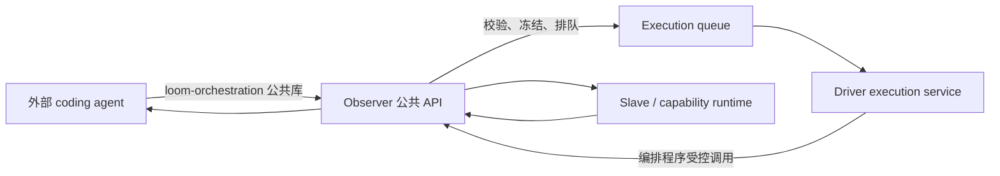

# 外部 Agent 编排与 Driver 执行专用化

**日期：** 2026-10-11

**状态：** 待评审，未实现

**取代：** [外部 Agent 规划与 Driver 独立执行](2026-10-09-external-agent-plan-submission-design.md)中关于内置规划、message API 和 DriverMCP 规划工具的部分

本文与 2026-10-09 spec 冲突时，以本文为准。2026-10-09 spec 中关于执行队列、Driver lease、Node/Attempt fencing、结果验证和无模型执行的可靠性约束继续有效；其中“保留内置 planner”“保留 `/api/v1/messages`”“保留 conversation projection”及“DriverMCP 规划工具”均作废。

**遵循：** [Spec 设计规范](../spec-design-guidance.md)

## 1. 问题

当前 Driver 同时承担四类职责：

1. 接收 Observer 的自然语言 message receipt，并维护 coding-agent turn；
2. 通过 `DriverMCP` 让 agent 逐步执行 `open_run → patch → readiness → commit → start`；
3. 在执行期间决定动态节点、资源关系和多个编排步骤；
4. 在受限容器中执行已经提交的 Python 编排程序。

这使“谁决定任务如何运行”和“谁执行不可变程序”处在同一个服务内。外部 agent 无法直接拥有完整的编排生命周期，只能模拟 Driver 的多个中间工具调用；取消模型 turn、Driver 重启和执行失败也容易被混淆。`/api/v1/messages`、`/driver/v1/messages`、message receipt、Driver thread 和对话投影都是这条旧路径的持久化负担。

目标架构是：外部 agent 完成发现、编排、计划生成、静态校验和修复；Observer 原子地校验、冻结并排队完整计划；Driver 只领取并执行已冻结的普通程序或编排程序；Slave 负责实际能力运行。Driver 不再拥有规划模型、编排决策或 Run 草稿工具。

本设计不保持旧规划接口的向后兼容。旧接口、旧数据库对象和仅服务于它们的代码直接删除，不增加兼容转发层。

## 2. 目标

1. 外部 agent 可以仅使用 Observer 公共数据面和新的编排库，上传内容、构造完整 `ClosureContract`、提交并跟踪一个 Run。
2. 一次提交在 Observer 内完成校验、版本冻结、执行请求创建和排队；外部 agent 不再依赖 `open_run`、`apply_plan_patch`、`inspect_plan_readiness`、`commit_plan` 或 `start_run` 的多次交互。
3. Driver 进程不构造或调用 coding-agent provider，不接收 prompt，不维护 conversation/thread/message receipt，只执行 execution queue 中的不可变计划。
4. `container:python_orchestrator/1` 继续作为 Driver 的执行器，负责在沙箱中运行外部 agent 提交的编排源码并把受控节点、资源登记、activation 和认证等待调用交给 Observer。
5. 提供一个可独立安装的 `loom-orchestration` 公共库，封装公共契约、计划构造、编排程序入口类型、内容上传、package 注册、提交、轮询、取消和 repair resubmit；库不访问内部 endpoint，也不实现另一套调度器。
6. 删除 Observer message API 及其完整内部链路；Run 状态和结果成为唯一的任务反馈来源。
7. 保留现有 Driver → Observer → Slave 中继、能力包、资源/activation、Node/Attempt、结果验证、Driver lease 和执行恢复语义；创建资源、等待用户认证、使用资源和清理资源可以属于同一个 Run。

## 3. 非目标

- 不让外部 agent 直连 Driver、Slave、Docker、数据库或 Observer internal API。
- 不在 Observer 或 `loom-orchestration` 中新增通用工作流 DSL、消息队列或第二套 Run 状态机。
- 不把能力包领域逻辑、provider SDK、认证流程或资源清理逻辑移入 Driver core；这些仍由 capability package、外部 agent 计划和现有 Observer/Slave 生命周期接口承载。
- 不保证外部副作用具有 exactly-once；未知 Attempt 仍按现有对账和 repair 语义处理。
- 不保留自然语言消息作为隐藏的规划后门，也不通过 `conversation_ref` 自动创建 Driver thread。

## 4. 角色边界



| 角色 | 负责内容 |
| --- | --- |
| 外部 agent | 读取能力和 metadata，选择节点关系，生成编排源码和完整 closure，处理 readiness blocker、repair outcome 和用户决定 |
| `loom-orchestration` | 提供公共类型和最小 helper；把外部 agent 的材料组合成一次完整提交；不替 agent 做领域决策 |
| Observer | 验证 workspace、引用、schema、package、预算和编排准入；创建不可变版本和 execution request；保存 Run/Node/Attempt、结果和证据 |
| Driver | 注册 lease，领取 execution request，执行普通程序或 `container:python_orchestrator/1`，恢复和上报执行事实；不规划、不修改 closure |
| Slave | 按 Observer 转发的固定请求运行能力包、维护 activation/health 和本地执行账本 |

`conversation_ref` 可以作为外部 agent 自己管理的相关标识写入 submission，但它只是可选的 Run metadata，不创建消息、对话投影或 Driver thread。

### 4.1 Package、Resource 与 Activation

三者不是同一个对象：

| 对象 | 含义 | 部署后是否产生另一个对象 |
| --- | --- | --- |
| Capability package | 不可变的能力定义、descriptor、IoContract 和 runtime body，回答“能做什么、如何调用” | 注册 package 不自动创建 resource 或 activation |
| Managed resource | 外部领域对象的稳定身份，例如一台 VM；保存 `resource_ref`、使用它的 `package_ref` 和可选的 `managed_by_ref` | 由 create 节点返回身份后显式 `register_resource` |
| Capability activation | 某个 package 版本在指定 Slave 上运行的具名实例，包含 target Slave、instance name、digest、revision、desired/actual state 和 health | provision/deploy package 后创建或更新 activation，不把它登记为 generic resource |

因此，能力包部署到某个 Slave 后，产生的是一个 `CapabilityPackageActivation`，通常经历 `provisioning → pending_auth/ready` 等状态；它本身不是 VM、Kubernetes job 等业务 resource。activation 可以带 `target_resource_ref`，表示该运行实例服务于哪一个已登记 resource，但这个关联不会把 activation 和 resource 合并。编排程序先用 `register_resource` 登记创建出的 VM，再用 `ensure_activation` 创建绑定该 VM 的访问 activation。

Observer 对这条关系提供反向查询：

```http
GET /api/v1/resources/{resource_id}/activations
```

响应返回当前 workspace 中 `target_resource_ref` 精确匹配该 resource 的 activation，并包含 package version/digest、target Slave、instance name、activation revision、desired/actual state、health 和 `instance_config`。调用方可以用 `package_ref`、`instance_name`、`activation_state` 查询参数进一步收窄结果；Observer 不返回其他 workspace 的 activation，也不把“同一 Slave 上可用”当成目标 resource 的绑定。

如果存在多个匹配 activation，外部 agent 按 resource effect 声明的 package、具名实例和 `ready` 状态选择；没有 ready activation 时使用 pending/auth 状态进入认证等待或发起 activation。`ensure_activation` 必须先执行同一反查并按 `(package_ref, target_resource_ref, instance_name)` 复用当前 revision，不能无条件创建第二个实例。

## 5. 外部编排库

### 5.1 包和边界

新增独立包 `loom-orchestration`，源代码放在仓库的 `packages/loom-orchestration/`，通过独立的 `pyproject.toml` 构建；它不依赖 `loom_v2.observer`、`loom_v2.driver`、SQLAlchemy、Docker 或 coding-agent SDK。库只依赖项目已经使用的 Pydantic 和 HTTP 客户端能力，若现有依赖足够则不引入新库。

库的公共模块保持窄边界：

```text
loom_orchestration/
  contracts.py    # ResourceRef、ClosureContract、TaskClosure 的公共提交模型
  program.py      # 编排入口 Protocol 和受控 context 类型
  package.py      # 编排 package manifest 构造
  client.py       # Observer 公共 HTTP data plane / submission API
  polling.py      # 有界的 submission/run 查询 helper
```

库不得导出 repository、internal command、WorkerSession、Driver lease 或数据库模型。外部 agent 可以把 `ClosureContract` 作为普通 Pydantic 对象修改，但必须通过 `build_submission()` 一次性提交完整计划。

### 5.2 编排程序入口

`program.py` 只描述 Driver 沙箱提供的受控协议，不把网络客户端或凭据客户端带入程序：

```python
class OrchestrationContext(Protocol):
    async def read_json(self, ref: ResourceRef) -> Any: ...

    async def materialize_json(self, *, step_id: str, value: Any) -> ResourceRef: ...

    async def register_resource(
        self,
        *,
        step_id: str,
        resource_type: str,
        identity: str,
        package_ref: ResourceRef,
        managed_by_ref: ResourceRef | None = None,
    ) -> ResourceRef: ...

    async def ensure_activation(
        self,
        *,
        step_id: str,
        package_ref: ResourceRef,
        target_resource_ref: ResourceRef,
        instance_name: str,
        instance_config: dict[str, Any],
        requires_authentication: bool,
    ) -> ResourceRef: ...

    async def wait_activation(
        self,
        *,
        step_id: str,
        activation_ref: ResourceRef,
        ready_state: str,
    ) -> dict[str, Any]: ...

    async def defer_cleanup(
        self,
        *,
        step_id: str,
        resource_ref: ResourceRef,
        cleanup_operation_ref: ResourceRef,
        input_mapping: dict[str, Any],
    ) -> None: ...

    def emit_node(
        self,
        step_id: str,
        package_ref: ResourceRef,
        capability_descriptor_ref: ResourceRef,
        input_refs: list[ResourceRef],
        *,
        target_resource_ref: ResourceRef | None = None,
        activation_ref: ResourceRef | None = None,
    ) -> str: ...
    async def result(self, handle: str) -> ResourceRef: ...


async def orchestrate(
    ctx: OrchestrationContext,
    input_ref: ResourceRef,
) -> ResourceRef: ...
```

`ProgramSource` helper只负责读取 UTF-8 源码、检查唯一的 `async orchestrate` 入口和生成不可变 content upload 请求。它不执行源码，不绕过 Driver sandbox，也不向源码注入 Observer URL、token、文件路径或环境变量。`step_id` 是源码作者提供的稳定逻辑标识，用于重启、认证暂停和重放时复用已确认的资源、activation 和节点结果。

这些 lifecycle 原语不是通用 HTTP 客户端：程序不能提交登录密码、授权码、cookie、token、私钥或任意 URL。包契约允许的非敏感连接配置（例如 VM 的 host、port、user）仍可从节点结果构造。`materialize_json` 把动态输入保存为内容引用，并登记为本 execution 可使用的输入；Observer 继续检查 schema 和内容大小。`ensure_activation` 创建或复用一个由 Observer/Slave 管理的 activation；`wait_activation` 仅在满足声明的就绪条件时返回，否则按第 6.4 节暂停或报告结构化失败。节点调用必须使用明确的 resource/activation 绑定，Observer 核对 package digest、目标资源、实例和 activation revision，不能回退到 default 实例。

认证交互由 Run 的非终态等待投影和公共认证 API 交给外部 agent/用户处理。编排程序拥有发起认证等待、超时分支和后续执行的控制流；Driver 机械执行这些指令。认证回调及最终凭据仍由能力容器处理。

第一版不增加任意 Python AST 转换器、metadata 编译器或通用流程 DSL。外部 agent 可以手写使用上述 context 的小程序；需要基于 `resource_effects` 组合流程时，由外部 agent 根据已验证 metadata 生成源码，Observer 只做结构化 preflight 和引用校验。超出现有 lifecycle 原语支持范围的领域流程，交给业务 capability operation 或外部 agent 自有程序处理。

### 5.3 计划和 package helper

库提供两个组合 helper：

```python
package = OrchestratorPackage(
    program_content_ref=program_ref,
    allowed_node_package_refs=[...],
    max_nodes=32,
    max_live_nodes=8,
).manifest()

submission = SubmissionBuilder(
    goal="...",
    body=task_closure,
    orchestrator_package=package_ref,
    input_binding=input_binding,
    resource_budget={"execution_timeout_seconds": 3600},
).build(request_id="request-...", conversation_ref=None)
```

`OrchestratorPackage` 只构造现有 `function + container:python_orchestrator/1` contract 所需字段，package digest 和所有 content digest 继续由 Observer 返回或计算；调用方不得手写 digest。`SubmissionBuilder` 只组装现有 `ClosureContract`/`TaskClosure`，不新增平行计划格式。`allowed_node_package_refs`、descriptor ref、input ref 和 `NodeInputBinding` 必须是 Observer 返回的精确 `ResourceRef`。

编排源码不直接提交到 Driver。传递链固定为：

```text
外部 agent
  → Observer POST /api/v1/content
  → Observer 返回 program_content_ref
  → 注册或物化 orchestrator package
  → ClosureContract.program_systems.package_ref
  → Observer 冻结并排队
  → Driver 领取后按 content ref 从共享 ContentStore 读取
  → Driver sandbox 校验 digest 并执行
```

Driver 不提供程序上传接口，也不接受本地路径、临时源码或 HTTP body 中的可变程序。已经发布的 orchestrator package 只需在 closure 中引用；一次性程序可以作为 Run-bound package 上传并绑定到该 Run。Observer 是内容和 package 引用的权威入口，Driver 只读取已冻结引用并执行。

### 5.4 公共客户端

`LoomClient` 只调用以下公共路径：

```text
POST /api/v1/content
POST /api/v1/capability-packages
POST /api/v1/run-submissions
GET  /api/v1/run-submissions/{request_id}
GET  /api/v1/runs/{run_id}
POST /api/v1/runs/{run_id}/resubmit
POST /api/v1/runs/{run_id}/cancel
POST /api/v1/runs/{run_id}/resolve
POST /api/v1/runs/{run_id}/close
GET  /api/v1/capability-packages
GET  /api/v1/capability-descriptors
GET  /api/v1/slaves
GET  /api/v1/resources
GET  /api/v1/resources/{resource_id}/activations
POST /api/v1/capability-packages/{package_ref}/auth/start
```

浏览器认证另由随能力包交付的本地助手调用 `POST /api/v1/auth/browser/bridge`；它是专用的瞬态认证通道，不是被删除的任务 message API。`auth/start` 请求必须带 `approved_digest`、`target_slaves` 和 `instance_name`，这些值直接取自 `waiting` 投影；客户端只在瞬态 `auth/start` 响应中接收助手配置和短期 session token，不将其写入提交 body、Run 事件或 ContentStore。

客户端自动保留 `request_id`、发送相同 canonical body 的幂等重试，按 Run 的 terminal/repair/decision/waiting 状态返回结构化结果。认证 helper 的最小调用为 `start_auth(package_ref, approved_digest, target_slave, instance_name)`，它只接受 Run waiting 投影中的精确引用；它不重试不确定的外部副作用，也不把 HTTP `202` 当作完成。

## 6. Run 生命周期迁移

### 6.1 外部 agent 承担的中间步骤

以下 DriverMCP 工具和对应的多次状态变更全部移出 Driver：

```text
loom_open_run
loom_query_capabilities
loom_put_content
loom_apply_plan_patch
loom_inspect_plan_readiness
loom_list_run_capability_packages
loom_commit_plan
loom_start_run
loom_get_run_status
loom_close_run
loom_resolve_run
```

其中 `put_content`、capability discovery、status、resolve、close 的能力仍存在，但通过 `loom-orchestration` 或公共 Observer API 完成；不再作为 Driver 的模型工具。外部 agent 在本地完成多步构造后，调用一次 `POST /api/v1/run-submissions`。Observer 在一个事务边界内执行：

```text
validate complete ClosureContract
→ validate content/package/descriptor/schema refs
→ run orchestration preflight and budget checks
→ create immutable closure version
→ create idempotent execution request
→ return 202 queued
```

Observer 不保存外部 agent 的草稿 patch 序列。修复使用一次 `POST /api/v1/runs/{run_id}/resubmit`，提交完整替换计划并带 `base_closure_version`；旧版本、节点、Attempt 和失败证据仍保留为 Run 历史。

### 6.2 Driver execution service

从现有 `DriverService` 提取 `DriverExecutionService`，只依赖 control client、ContentStore、WorkerSession、`DynamicOrchestrationRuntime` 和 settings。它：

- 启动时注册 Driver lease，并运行 `execution.claim_next` 循环；
- 领取后按冻结的 execution envelope 执行普通程序或编排程序；
- 捕获不可变的 `driver_id`、`driver_instance_id`、`driver_epoch`，所有 Observer 写入都做 fencing；
- 在 Driver 重启或 lease 变化后按 execution request 和既有 Attempt 记录恢复；
- 只把执行结果、动态节点事实、清理错误和证据写回 Observer。

领取执行请求后，Driver 先从共享 ContentStore 读取 closure 指定的 package body 和 `program_content_ref`，再次核对 package digest、content digest、允许节点包和预算；读取失败或摘要不匹配直接产生结构化 execution blocker。Driver 不从外部 agent、浏览器或消息接口接收源码。

删除 `provider`、`prompt`、`TurnContext`、`DriverTurnCoordinator`、`active_turns` 和 coding-agent deadline。执行 timeout 只由 submission 中固定的 `resource_budget.execution_timeout_seconds` 决定，不受外部 agent 进程或 HTTP 连接存活影响。

`DynamicOrchestrationRuntime` 保留为执行组件；它不能创建 closure、选择 capability relationship 或修改计划。它加载已冻结的 `program_content_ref`，将沙箱发出的内容、节点及 lifecycle 原语映射到 Observer 的受控协议。认证暂停不产生失败 outcome；编排程序失败、超时或恢复不确定时返回结构化 Run outcome，交给外部 agent resubmit 或人工处理。

### 6.3 Observer 命令和路由

保留并作为唯一提交/执行控制面：

```text
POST /api/v1/run-submissions
GET  /api/v1/run-submissions/{request_id}
GET  /api/v1/runs/{run_id}
POST /api/v1/runs/{run_id}/resubmit
POST /api/v1/runs/{run_id}/cancel
POST /api/v1/runs/{run_id}/resolve
POST /api/v1/runs/{run_id}/close
```

删除公开 `run open/patch/readiness/commit/start` 路由。删除内部 `run.open`、`run.patch`、`run.readiness`、`run.commit`、`run.start` 和只为这些步骤服务的 repository adapter。内部只保留原子 `execution.enqueue`、`execution.claim_next`、节点、结果、恢复、activation/认证和生命周期命令；它们不接受外部 agent 可伪造的 workspace、owner、state 或 digest。

`run-submissions` 的 request body 仍复用现有 `ClosureContract`，不另建 orchestration plan DSL。提交 response 只表示已排队；结果从 Run record、outcome、dynamic nodes、attempts 和 evidence 获取。

### 6.4 单 Run 的认证暂停与恢复

创建 VM、等待认证、执行 VM 上的操作和清理 VM 不需要拆成多个 Run。典型程序是：

```text
emit create node
→ read result and register resource
→ defer cleanup
→ ensure activation
→ wait activation
→ emit VM operation nodes
→ cleanup
```

当 `wait_activation` 发现 activation 为 `pending_auth` 时，Driver 宿主向 Observer 发送一次幂等的 `activation_wait` 结果。Observer 原子保存等待记录，将 Run 和 execution request 置为新增的 `awaiting_auth` 状态，并清除当前 Driver owner；`outcome` 仍为空。公开 `waiting` 投影包含 `step_id`、精确 package/activation 引用、目标 Slave、实例名、activation revision、截止时间和 `action=authenticate`。Driver 收到暂停响应后关闭沙箱并结束当前本地 task，不把等待误报为程序失败，也不结算执行请求。

外部 agent 查询 Run 后，对该实例调用公共 `auth/start`，把登录入口或设备码展示给用户，并把短期助手配置直接交给本地认证助手。授权码经专用 bridge 转发到能力容器；密码、授权码、session token 和最终服务凭据不进入 Run。普通轮询和编排重放不会重复调用 `auth/start`，以免作废用户正在使用的登录会话。

认证完成后，Observer 根据当前 activation 的权威 health 自动唤醒同一个 execution，不新增手动 resume 接口。状态路径为 `running → awaiting_auth → running`；execution request 从 `awaiting_auth` 进入 `recovering`，Driver 重新领取后恢复。`run_id`、closure version 和逻辑 `execution_id` 保持不变；`driver_epoch` 可更新，`execution_epoch` 在单纯认证暂停恢复时保持不变，只有已有 recovery/reassignment 规则要求重新执行时才递增。等待登记和 health 更新使用相同的状态复核边界；Observer 启动扫描重新检查持久化等待记录，避免认证先完成或进程重启导致永远等待。

Driver 从同一源码重放，通过 `(execution_id, step_id)` 复用已完成的 create、resource registration、cleanup registration 和 activation。每个有副作用原语保存规范化参数和已确认结果；同键不同参数报 conflict，未确认结果先对账，不能重新创建 VM。暂停时既有并行 Attempt 的归属和结果继续保存在 Observer/Slave，恢复前先对账，不重新派发。`wait_activation` 的唤醒还须重新核对目标实例和 revision，不能仅复用历史 ready 状态。

`awaiting_auth` 是执行中的可恢复暂停，不是 repair，也不是新 Run。登录会话过期时，外部 agent 可在同一 activation 上重新发起认证，Run 继续等待。认证等待计入既有绝对 execution deadline，重新登录或重启不延长预算。取消、超时、activation 被替换或不可恢复失败时，Observer 将已登记的 cleanup ledger 作为受限 cleanup continuation 放回执行队列；Driver 在沙箱已释放后继续处理清理，记录失败及仍存活的资源。等待本身不触发 cleanup，不能在用户登录时销毁 VM。无法证明有副作用步骤的结果时进入 `execution_recovery_required`，交由外部 agent 处理。

这要求同步扩展 sandbox 协议、公共编排库类型、preflight stub/allowlist、内部宿主命令、Run/execution request 状态机和投影，而不只是添加 Python Protocol。sandbox 至少增加 `materialize_json`、`register_resource`、`ensure_activation`、`wait_activation`、`defer_cleanup`、带 resource/activation binding 的 `emit_node`，以及 `activation_wait` 的暂停帧。`defer_cleanup` 登记的精确 operation、输入映射、访问实例及预算必须由 Observer 校验并持久化；终态清理使用预留预算，不能绕过 Run 的效果授权。新增原语和认证等待属于待实现能力，当前仅有 `read_json`、`emit_node`、`result` 无法完成这一闭环。

状态机固定为：

```text
Run:   committed → running → awaiting_auth → running → terminal
Queue: queued → claimed → awaiting_auth → recovering → claimed → settled
```

`awaiting_auth` 不产生 terminal outcome，不占用 Driver owner；`recovering` 只表示等待重新领取。取消、deadline、执行失败和无法恢复的副作用从任一非 terminal 状态进入 terminal/repair，并按 cleanup ledger 继续清理。单纯认证恢复不新建 Run、closure version 或 execution_id。

## 7. Message API 和对话链路删除

### 7.1 删除范围

删除以下 HTTP 路由和传输：

- Observer `POST /api/v1/messages`；
- Driver `POST /driver/v1/messages`；
- Observer/Driver conversation interrupt 中依赖 message receipt 的分支；
- Observer `/mcp` 或 gateway 中将消息转发给 Driver 的路径。

删除对应持久化和代码：

- `MessageReceipt`、`PublicMessageRequest`、`DriverMessageRequest`；
- `message_receipts` 表、dispatch index、`driver_threads` 表和 thread binding；
- `ObserverMessageDispatcher`、`DriverTurnCoordinator`、message claim/update/release/append 命令；
- `loom_v2/coding_agents/`、Driver provider/bootstrap 配置及 Codex/Fake planner；
- `list_conversations`、`get_conversation`、message receipt projection 和前端聊天提交逻辑。

旧 Run 的 `origin_conversation_ref` 可作为历史字符串保留在 closure JSON 中，但新提交不创建 conversation resource；不再提供 conversation 查询 API。历史 `events` 中已有的 message/assistant 事件按不可变历史数据读取，不再产生同类新事件。

数据库迁移新增一个 revision 删除 message receipt、driver thread 及其索引；部署切换前必须停止接受旧 message 请求并处理仍在 `in_flight` 的旧 turn。迁移不为旧 receipt 补造 execution request，也不把旧 conversation 恢复成新的外部 submission。

### 7.2 Web、README 和运行配置

Web UI 不再提交自然语言消息或显示 assistant turn；它只展示通过外部 agent 提交的 Run 查询结果，或明确提示使用 `loom-orchestration` 客户端。Driver 镜像不再安装 Codex app-server、模型配置和模型 secret；`coding_agent_backend`、`codex_model`、Codex secret 和相关 compose 挂载删除。Driver health 只报告 execution lease、queue claim 和 runtime 能力。

## 8. Skill 更新

`skills/personal-computing-space/SKILL.md` 及其 `references/observer-workflow.md` 改成外部 agent 专用流程：

1. 检查 Observer health/runtime，并发现 Slave、package、descriptor、schema 和 resource effects；对已有 resource 调用 `/api/v1/resources/{resource_id}/activations` 反查可复用的 activation；
2. 使用 `loom-orchestration` 上传输入、程序和契约内容，注册所需 package；
3. 使用 `SubmissionBuilder` 构造完整 `ClosureContract`，一次提交 `POST /api/v1/run-submissions`；
4. 轮询 submission/Run，按 `completed`、`failed`、`awaiting_decision` 和 `repair` 处理结构化结果；
   遇到 `awaiting_auth` 时读取 `waiting`，为精确实例发起认证并展示登录操作，继续跟踪同一 Run，不提交第二个 Run；
5. repair 使用完整替换计划和 `base_closure_version`，cancel 只在明确请求时调用；
6. 永不调用 Observer `/mcp`、Driver `/driver/v1/*`、Observer `/internal/v1/*` 或 Slave `/worker/v1/*`，永不计算或伪造 digest。

Skill 删除 message API、conversation polling、Driver planner、自然语言 prompt 模板和“Driver 可用即代表可规划”的说明。示例改成一个无副作用普通函数计划和一个 `container:python_orchestrator/1` 动态节点计划。

## 9. 安全与一致性

- Observer 在提交时重新解析每个 `ResourceRef`，检查 workspace、digest、package contract、descriptor、IoContract、input binding 和允许节点包；不信任库生成的派生字段。
- 编排源码继续通过 AST 检查、Pyright/入口签名检查和 Docker 无网络、只读 root、非 root、capability drop、资源上限的沙箱执行。
- Driver 只允许从已冻结 package body 读取 `program_content_ref`，不接受提交后由 agent 修改的本地文件或环境变量。
- `max_nodes`、`max_live_nodes`、execution deadline、输入大小和协议消息大小在 Observer 提交时固定，在 Driver 执行时再次强制。
- `emit_node` 只能引用 closure 允许的 package、descriptor 和 content ref；未知或跨 workspace 引用使 Run 进入明确 repair outcome。
- 外部 agent 退出、HTTP 断开或本地 polling 取消不会自动取消已排队/运行的 Run；只有公共 cancel API 改变执行意图。
- Driver 丢失 lease 时，Observer 以 execution owner/epoch fencing 拒绝旧写入；已完成节点复用已记录结果，未确认的有副作用 Attempt 进入现有 recovery/repair 语义，不盲目重放。
- 编排程序可以等待人工认证，但只能通过 activation 原语暂停；Driver 不持有浏览器 cookie、授权码或服务凭据。

## 10. 实现和删除清单

| 区域 | 修改 |
| --- | --- |
| `packages/loom-orchestration/` | 新增公共类型、program Protocol、package/submission builder、Observer client 和 polling helper |
| `loom_v2/observer/app.py`、`repository.py`、`control` | 保留完整 submission/query/resubmit/cancel/resolve/close；删除 message、公开 Run 草稿步骤和 thread/turn 命令 |
| `loom_v2/driver/` | 新增/保留 execution-only service；删除 `mcp.py`、`mcp_server.py`、planner service、coordinator、provider、prompt 和直接规划工具 |
| `loom_v2/driver/orchestrator.py`、`orchestration_runtime.py` | 保留沙箱执行和节点 callback，拆出不依赖规划的 execution component；禁止生成或修改计划 |
| `loom_v2/contracts/` | 删除 message/thread/turn contract；复用 `ClosureContract`、`TaskClosure`、Node/Attempt 和 execution request contract |
| `loom_v2/db/`、`migrations/` | 删除 message receipt/driver thread 模型和表，新增清理迁移；保留 Run、execution request、node、attempt 历史 |
| `deploy/`、`Dockerfile.driver`、`settings` | 删除模型、Codex、planner secret 和配置；Driver 只需要 Observer、ContentStore、runtime 执行配置 |
| `skills/`、`README.md`、Web、examples、tests | 改为外部 agent submission 工作流，移除消息/对话和 Driver planner 示例 |

同步删除 `run_executor` 注入、MCP 内 dispatch/wait loop、`prompt` 透传、由模型 turn 存活决定执行存活的分支、message dispatcher 和仅为兼容旧测试保留的路由。不要留下空的 planner 抽象或伪造 conversation receipt。

## 11. 验收标准

1. **外部一次提交：** 外部 agent 使用 `loom-orchestration` 上传源码和输入，提交完整 closure；Observer 一次返回 queued Run，不需要 open/patch/commit/start。
2. **Driver 无规划依赖：** `coding_agent_backend`、模型 secret 和 provider 不存在时，Driver 仍能注册、领取、执行普通程序和 `container:python_orchestrator/1`，且不会创建 thread 或 message receipt。
3. **动态编排执行：** 外部源码能通过 `read_json`、`emit_node`、`result` 产生多个动态节点；Driver 只执行源码，节点和结果仍由 Observer 持久化。
4. **引用与安全：** 缺失/错误 digest、越权 package、非法入口、超预算、网络/文件访问和未知节点引用均在提交或执行时返回结构化 blocker；不会静默替换引用。
5. **提交幂等与修复：** 同一 request id 的重试只得到同一 Run；repair 使用完整替换计划和版本 fencing；历史版本和失败证据可查询。
6. **恢复与取消：** Driver 重启、lease epoch 变化、claim 响应丢失、结果写入后断线和执行中 cancel 不依赖外部 agent 进程存活，也不重复确认完成的有副作用节点。
7. **Message 删除：** `/api/v1/messages`、`/driver/v1/messages`、旧 conversation interrupt、message receipt/thread 表和相关命令均不可用；新的任务反馈只来自 submission/Run API。
8. **Skill 可用：** skill 不包含旧 message、Driver planner 或内部 endpoint 调用，能指导 agent 完成 discovery、一次提交、poll、repair、cancel 和 result verification。
9. **单 Run 认证闭环：** 使用测试能力包验证 create → register → activate → awaiting_auth → authenticated → exec → cleanup；断言仅创建一台 VM、沿用同一 Run/closure/execution，等待不触发 cleanup，认证完成后自动恢复。
10. **等待竞态与敏感信息：** 覆盖认证先于等待登记完成、Observer/Driver 重启、会话过期后重新登录、activation revision 改变、等待期间取消及 deadline；已完成节点不重复派发，取消/超时仍执行已登记清理，Run/事件/内容存储中不出现 session token 或授权码。

## 12. 实施顺序

1. 先实现 `loom-orchestration` 的公共模型、客户端和 submission builder，并为一次完整提交建立契约测试。
2. 将 Observer 的完整提交校验、冻结和 enqueue 收敛为原子路径，删除公开 Run 草稿步骤。
3. 把 Driver 执行循环和编排沙箱与 planner 解耦，在无 provider、无模型 secret 的环境完成普通和动态编排执行。
4. 删除 message/thread/turn 持久化、路由、内部命令、数据库对象和 Web planner 路径，完成迁移。
5. 更新 skill、README、部署配置、示例和测试，覆盖幂等、恢复、取消、repair、资源清理和多节点执行。

本 spec 只定义重构目标和接口；本轮不修改实现、不迁移数据库、不删除现有 API，也不执行真实云资源操作。
