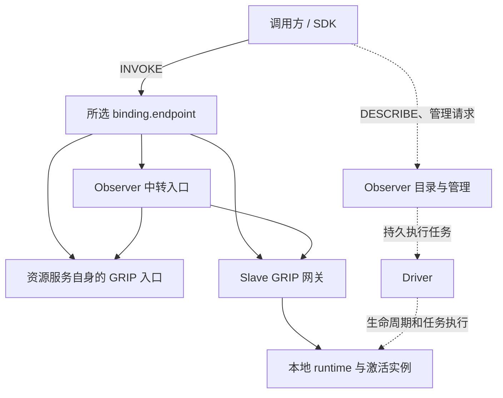
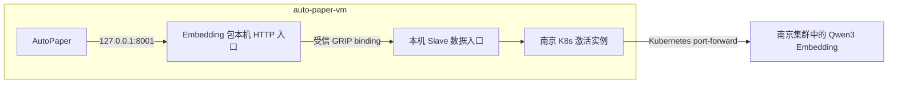

# GRIP binding 路由与有状态服务访问

日期：2026-10-23。状态：已按评审意见实现，2026-10-24 完成本地验证、生产部署和 AutoPaper 切换。
实现证据见 [本地验证报告](../reports/2026-10-24-grip-bindings-service-streams.md)，实际部署、验收范围及剩余限制见
[生产部署记录](../reports/2026-10-24-grip-bindings-production.md)。第 2 节保留设计时的现状记录。

遵循 [spec 设计规范](../spec-design-guidance.md)。协议依据为 [GRIP 协议整理 v2](/root/computility_named_resource/grip协议整理v2.md)，重点采用第 4.4 节的 binding、第 7 节的字节流及第 8 节的传输绑定扩展契约。

本设计不要求向后兼容。发生契约变化的能力包使用新版本，SDK、Slave 和运行时按新契约配套升级，不根据调用方版本猜测语义。已有任务执行模型仍是一种有效能力，不因增加服务直连而删除。本文替代旧设计中“所有资源使用必须经过 Observer”“所有激活实例的业务调用都返回 Run”的限制。

## 1. 目标与主要决策

INVOKE 的访问方式由 DESCRIBE 中所选 action 的 binding 决定。binding 可以指向资源服务自身、Slave 网关、Observer 中转或其他受信接入服务；GRIP 不规定接收端必须是 Slave，也不规定数据必须经过或必须绕过 Observer。

Observer 在 Loom 部署中提供可信发现和管理，也可以作为 binding 的接收端中转业务请求或字节流。Driver 承担持久任务执行。调用方使用逻辑资源 URI 和动作契约，不从部署角色推导 INVOKE 地址。

本次以 AutoPaper 访问南京集群的 embedding 模型作为完整落地场景：在 auto-paper-vm 上运行 Slave、南京 K8s 激活实例和 embedding 激活实例；AutoPaper 使用本机稳定入口，K8s 实例管理认证和集群服务连接，模型仍在南京集群执行。

主要决策：

1. 保留 GRIP 的 DESCRIBE / INVOKE 两个核心方法，使用现有 binding 字段和 `request-reply` / `byte-stream` 两种 mode。
2. 由部署按需要发布直连或中转 binding；Slave 网关是一种可选实现，Observer 中转也是正式支持的实现。AutoPaper 首批选择本机 Slave 承载入口。
3. 能力包明确声明任务、业务请求回复或字节流交互；交互语义和访问路径分别定义，同一 action 的所有 bindings 保持相同业务契约。
4. 首批实现 HTTPS JSON 和一连接一条流的 WSS 绑定，并支持它们在直连及 Observer 中转入口上的使用。连接复用属于客户端与绑定实现，不引入核心 session 或 stream_id。
5. 身份服务签发限定目标、动作和受众的访问凭据，数据入口本地校验。Kubernetes 凭据始终由对应激活实例持有。
6. 持久化服务访问配置和认证缓存，恢复时重建连接；断流后的原业务请求明确失败，不重放已经发送的业务字节。

## 2. 当前实现与差距

| 当前实现 | 本设计需要补齐的部分 |
|---|---|
| Observer `GripService.offer()` 将 binding 指向 Observer | 按资源部署和 action 契约发布可用 bindings，允许直连与中转共存 |
| SDK 限制 endpoint 与 Observer 同源、audience 为 workspace | 受信路由、按受众取得凭据、按描述选择 binding，不识别或强制接收端角色 |
| SDK `invoke()` 只处理普通回复，Reply 只接受 reply/error | 增加建流回复及本地 Stream 接口 |
| 所有包导出调用包装为参数、revision、幂等键并返回 Run | 保留任务调用，增加直接业务结果与建流输出契约 |
| container HTTP 插件仅通过有界 JSON 调用服务 | 增加持续字节通道，保持背压和关闭传播 |
| 激活配置可持久化，Slave 启动时 reconcile，容器有 restart policy | 补齐服务连接恢复、依赖恢复及故障分类 |
| K8s v6 使用 `/tmp/loom-kube-home`，未启用 persistent_state | 登录缓存移到实例持久卷，重启不依赖重新扫码 |

代码依据：`loom_v2/observer/grip.py`、`loom_orchestration/client.py`、`loom_orchestration/grip.py`、`loom_v2/slave/service.py`、`runtime_plugins/container_http_v1/`、`capability_services/kubernetes_http/`。

现有 Slave 健康检查主要检查和上报，不代表全部故障都会自动恢复；其中 failed 生命周期状态不会由一次健康成功自动清除。新设计不能仅添加 Docker restart policy 就宣称已完成恢复。

## 3. 控制与数据路径

### 3.1 以 binding 选择入口



图中的三条实线路径是绑定选择的例子，一次调用只走选中的路径。Observer 的目录与中转可以部署在同一服务中；图区分其职责，不要求新增一个中转进程。控制边表示职责关系，当前内部控制转发不因本次设计自动改写。

协议和 SDK 只识别资源、动作、binding 及其信任配置，不增加 `backend_type=slave/observer` 一类核心字段。action.mode 不决定 endpoint，audience 标识实际接收服务，也不固定为 Slave URI。资源服务自带 GRIP 入口时，SDK 使用相同绑定实现访问，不要求它伪装成一个 Slave。

### 3.2 首批承载实现

为 AutoPaper 实现可按需启用的 Slave GRIP 网关，共享本机激活注册表、生命周期锁和运行时宿主。通过独立 ASGI 应用及监听配置暴露 GRIP 请求和建流路由；不发布 `/worker/v1/*` 或 runtime plugin 的私有接口。TLS 可由节点上的反向代理终止。部署可以只让网关对本机或 Observer 可达，不要求每个 Slave 都具备面向外部客户端的地址。

Observer 根据受信部署配置和实际服务注册信息发布 bindings，不从客户端 Host 或任意公开 MCUE 属性生成执行路由。对 Slave 托管实例可采用已验证的节点注册信息；对服务自带入口使用 operator 登记的受信服务路由。包作者声明交互能力和实现路径，部署决定接收地址、证书和可达范围。

对于 Slave 托管实例，最终执行端只使用已激活实例执行请求，不隐式创建实例。调用准入复用包身份、workspace、动作权限、输入契约和激活 revision 检查；准入与 stop 串行化，建立后释放生命周期锁。stop 先禁止新调用，再关闭所登记的活跃流和运行时资源，不能持有一把锁等待整个流结束。这些生命周期检查由实际承载端落实，中转入口不能替最终执行端省略检查。

### 3.3 Observer 中转语义

Observer 为需要中转的 action 发布自己的 HTTPS JSON 或 WSS binding。后端路由由受信部署解析并固定到同一资源和契约；客户端不通过 input 提交转发 URL。Observer 转发时保持 target、action、业务 input 和不放宽的 deadline，内部请求标记可以重新关联，但客户端只收到自己请求对应的一个回复。

对直接返回业务结果的 request-reply 动作，Observer 返回后端的业务结果或错误，不因中转而包装为 Run；原本返回 Run 的任务提交动作仍按自己的契约返回 Run。对 byte-stream 动作，只有后端完成准入并确认通道已建立后，Observer 才向客户端发送 stream-open；之后持续转发字节，并传播背压、正常结束、异常中止和关闭。数据实际经过 Observer，这是该 binding 的预期行为。

中转不通过 Driver 创建一个长期等待流的任务，不全量缓冲流，也不把 payload 写入 Run 或 ContentStore。后端连接的凭据按其 audience 取得，详见第 7 节；客户端面向 Observer 的凭据不会被原样转发给另一受众。

服务直连和中转共用协议收发与流转发代码。中转路由来自固定的部署关系，不能递归选择自身或形成环；发送后结果不确定时不重试后端，也不另选一条 binding 重复执行。

## 4. Action 契约与运行方式

### 4.1 三种包导出交互

在包导出的 `runtime_binding` 中增加 `interaction`，缺省值为 `task`。路径仍由 `path` 声明。该配置是包契约的一部分，参与包摘要，不进入 GRIP 核心 binding。

| interaction | 对外 action.mode | input / output |
|---|---|---|
| `task` | `request-reply` | 现有任务参数包装 / `{run: URI}` |
| `request-reply` | `request-reply` | IoContract 业务输入 / 业务输出 |
| `byte-stream` | `byte-stream` | IoContract 建流输入 / 建流确认输出 |

interaction 决定动作交互，不选择网络入口。入口由该 offer 的 bindings 单独提供；例如同一个 request-reply 或 byte-stream action 可以同时声明服务直连和 Observer 中转。当前 task 由 Observer 的持久提交实现承载，这是 Loom 的实现选择，不是 GRIP 的协议要求。

任务执行仍用于部署、管理、需要审计结果与持久恢复的操作。新 K8s 连接动作和 embedding 服务显式声明后两种交互。修改某个导出的交互方式会改变契约，必须发布新包版本和相应的新 action 身份，不能原地修改不可变包。

同一 action 不允许某个 binding 返回 Run、另一个 binding 返回向量。需要持久执行一个普通服务动作时，通过 `run-package` 或完整计划显式提交，提交动作与被执行的业务动作分别拥有自己的契约。字节流不能作为持久任务返回值保存，提交时拒绝将建流导出当作普通任务节点执行。

业务 request-reply 和 byte-stream 的 GRIP input 就是业务输入，不统一套一层 `arguments`，也不统一要求幂等键。确实需要幂等性的动作在自己的输入 Schema 中定义。托管激活实例调用所需的 revision 由授权与路由约束落实，直连和中转均须遵守，见第 7 节。

### 4.2 输出与失败

业务请求回复调用完成输入、输出及适用的 IoContract 成功校验后返回 `reply`。需要 Run 的验证证据和结果留存时，使用任务模型。服务调用及其中转只记录必要的审计元数据，不创建 Run，也不将模型输入输出保存到 Observer 或 ContentStore；中转时 Observer 在传输期间处理这些数据。

建流动作只有在对应上游连接成功后才能返回 `stream-open`。该确认表示通道已建立，不表示模型推理已经成功。建流失败返回一个 GRIP error；确认后的失败通过流中止报告，不能再发送第二个 GRIP 回复。

描述未就绪或不支持的绑定不予发布；持有旧描述的调用仍由数据入口重新校验。运行中出现提供方不可用等领域状态时，按动作的状态查询输出报告；建流失败保留本地结构化原因，不向 GRIP 核心随意添加错误码。

## 5. Binding、发现与本机访问

### 5.1 发现结果

描述中的 binding 继续只有 `protocol`、可选 `endpoint` 和可选 `audience`。新部署的服务入口均显式发布 audience；例如同一个字节流 offer 可以同时包含以下 bindings：

```json
[
  {
    "protocol": "loom-wss-stream.v1",
    "endpoint": "wss://autopaper-vm.example/grip/stream",
    "audience": "grip://loom.local/workspaces/workspace-default/slaves/autopaper-vm"
  },
  {
    "protocol": "loom-wss-stream.v1",
    "endpoint": "wss://observer.example/grip/stream",
    "audience": "grip://loom.local/workspaces/workspace-default"
  }
]
```

以上地址与 audience 是部署示意，不表示它们已经配置。真实 URI、action 与 bindings 均从描述返回值取得。这里一个 binding 使用 Slave 网关，另一个使用 Observer 中转；也允许受信资源服务直接发布自己的 endpoint。

Observer 在原有目录投影中组合“不可变动作契约”和“当前资源访问路由”。不得把含部署 endpoint 的完整 offer 放入仅按包摘要索引的缓存，导致同包不同实例或不同接入方式共用错误入口。

领域资源只有一个有效激活绑定时可投影其 offers；存在多个候选时继续要求调用方明确选择激活实例。多个 binding 表示访问同一目标和契约的方式，不用 binding 列表顺序偷偷选择另一个执行实例。

### 5.2 SDK 选择规则

1. 从可信 Observer 获取目标描述及契约，校验目标、可见性、revision 与有效期。
2. 根据 action URI、mode、已实现的 protocol、本地信任配置和调用方的路径偏好选择 binding；偏好匹配配置中的 endpoint/audience，可以选择本机直连或 Observer 中转，不从 URI 尾段猜测角色，也不在 SDK 中硬编码 Slave 优先。
3. 校验 endpoint 与 audience 的受信关联，取得适用于该接收服务的凭据，再建立连接。
4. 对普通 action 交换请求回复；对字节流 action 返回已建立的本地 Stream。

SDK 仅在发送 INVOKE 前选择候选入口。请求已经发送后发生超时或断连，不自动改走另一个入口重新执行。未知协议跳过；缺少必要能力时返回 `unsupported_binding`。

binding 已给出 endpoint 时使用该地址；省略时才使用 operator 安装的受信路由解析到对应接收服务。需要多个可达地址时，由描述提供相应 bindings。可选的本机路由不能把描述中的 Observer binding 擅自改为某个 Slave 地址。容器的 localhost、宿主机的 localhost 分属不同网络环境，不向所有客户端发布统一的 localhost 地址。配置失效时在发送凭据前失败。

首批使用 HTTPS/WSS，节点 DNS、TLS 和本机路由由部署准备。省略 endpoint 的绑定只在客户端已配置受信解析规则时可用。第一版不增加另一套 Unix socket 公共协议。

### 5.3 SDK 接口与缓存

保留 `describe()` 与 `invoke()`，增加 `open_stream(target, action, input)`。后者是 SDK 的本地接口，对应一次 GRIP INVOKE，不是新增网络方法。

Stream 提供异步 read、write、close 和异步上下文管理，区分正常结束与异常中止；退出上下文释放整个通道。首版绑定不支持半关闭，write_eof 明确报告不支持，要求半关闭的 action 不能选择此绑定。SDK 复用 HTTP 连接池；WSS 第一版一条连接对应一条字节流。

描述缓存遵循 expires_at，并按主体、workspace 和可见性上下文隔离；Schema 使用不可变身份缓存。凭据缓存按主体、audience、target、action 和激活 revision 隔离。业务调用不能每次重新获取一整组相同 Schema 或重复换取凭据。

## 6. `loom-wss-stream.v1` 绑定规范

该标识由 Loom 维护，用于本设计明确规定的线格式。GRIP 草案中的 `wss-stream.v1` 只是示例，不能假定其他实现与本绑定兼容。底层采用 [RFC 6455 WebSocket](https://www.rfc-editor.org/rfc/rfc6455.html)，通过 WSS 传输。

### 6.1 成功与失败线格式

1. 建立 WebSocket，协商子协议 `loom-wss-stream.v1`；HTTP Upgrade 成功不代表 GRIP 动作成功。
2. 客户端发送一个 UTF-8 text message，内容为完整 GRIP INVOKE，accepted_protocols 包含本绑定，auth 在该消息中提供。
3. 服务端完成认证、目标与 action 准入、Schema 校验和上游连接，发送唯一的 text message：`stream-open` 或 `error`。
4. error 后关闭；stream-open 后双方发送承载原始业务字节的 binary message，不再发送 GRIP 控制回复。消息边界不向业务暴露，不增加自定义 DATA 包头。

建流确认前不能发送业务字节；在错误阶段收到 binary message、建流后收到新的 text 控制消息或未知消息类型时，按协议错误中止。

本绑定不支持半关闭，任一方主动关闭或上游正常 EOF 都结束整条通道；待交付的入站字节先交给调用方，再报告正常结束。WebSocket 正常关闭握手使用 1000，网络断开及异常 close 报告中止。正常结束只说明绑定按规则关闭，上层仍须根据 HTTP 长度、响应状态等判断结果是否完整。

本次模型 HTTP/1.1 交互使用明确的消息长度或分块编码，不依赖半关闭划分请求。需要半关闭的其他动作应选择提供该能力的绑定，不能把 write_eof 悄悄实现为 close。这个选择避免在尚未验证 Kubernetes 转发行为前承诺端到端半关闭。

### 6.2 限制与生命周期

- 建流控制消息最多 64 KiB；每个 binary message 最多 64 KiB。底层 WebSocket 分片由库处理，限制按重组后的 message 执行。
- 每条流、每个方向默认缓冲上限 1 MiB；达到上限暂停读取，向上下游传播背压。该值由 operator 配置，不是流总大小上限。
- 建流等待默认 30 秒，并受更早的 GRIP deadline 限制。建流 deadline 不作为已建立流的存活期限。
- 节点限制每个激活实例的并发流数量，默认 64，支持部署调整。达到上限时在连接上游前拒绝，不无限创建进程或缓冲。
- 使用 WebSocket ping/pong 检测断连，默认空闲 20 秒发 ping、40 秒无响应中止。持续业务流量同样受授权期限约束。
- 协议错误关闭码 1002，超过消息上限 1009，授权撤销或到期 1008，上游及内部异常 1011。关闭原因不包含凭据或原始认证响应。
- 建流后连接最长存活到本次授权凭据的到期时间。SDK 不在字节阶段偷偷换凭据；应用在空闲边界使用新凭据建立新流。这个规则会使超长单次传输在到期时失败，调用前应检查剩余授权预算。

所有转发段都必须传播正常结束、异常中止和背压，包括所选路径中的 Observer 中转、Slave 网关、runtime plugin 与能力包服务之间的连接。关闭后的未完成业务不能被中间层重新连接并重发。

## 7. 认证、依赖授权与停用

### 7.1 区分两类认证

本节定义 Loom 托管资源的访问凭据和委托方式。SDK 的绑定层只依赖 GRIP auth 及已配置的凭据提供者，不要求所有接收服务都使用同一种 JWT、存在 Slave 或拥有 activation revision。服务自带的 GRIP 入口按其受信身份方案接入；托管实例额外执行下述生命周期约束。

Loom 访问认证决定谁能调用哪个资源的 action；Kubernetes 登录决定 K8s 激活实例能否访问上游集群。短期 Loom 凭据自动更新不触发 Kubernetes 扫码。Kubernetes refresh 失败且确认需要用户交互时，才进入统一登录流程。

Observer 同部署一个轻量的访问凭据签发端点 `POST /api/v1/auth/token`，属于身份服务接口，不是 GRIP action。外部客户端使用其已有 Observer 身份，提交 target、action、选择的 audience 和 expected_activation_revision；签发端从权威记录解析激活实例和权限，校验修订相符，再返回受限 access token 与 expires_at。调用领域资源时，SDK 根据唯一激活绑定取得该实例的描述与 revision，不猜测实例。响应使用 `Cache-Control: no-store`，请求、响应和凭据均不写入 Run、content 或普通请求日志。

此认证响应独立于 GRIP reply，符合草案中凭据由受信身份服务提供、不得放入资源描述和业务回复的边界。生产签发入口与数据入口均通过 TLS 访问。

托管资源的访问 token 使用标准签名 JWT，新增 `PyJWT[crypto]` 实现 Ed25519 签名和验签；现有依赖没有完整 JWT 签发/校验能力，不自制 token 编码或签名协议。签名私钥仅由身份服务持有，Observer 中转、Slave 网关等接收端通过 operator 配置的受信公钥校验；轮换保留上一验证公钥至已签发凭据到期。[PyJWT 使用文档](https://pyjwt.readthedocs.io/en/stable/usage.html)说明其签名与标准 claims 校验接口。

托管实例的 token 必须约束 issuer、subject、audience、workspace、target、action、解析出的 activation URI、activation revision、签发与到期时间。签发端不接受客户端自报的权限或 revision 作为授权事实。接收端校验 token，最终执行端比较本地当前状态和调用约束；领域资源重绑后不能继续用原凭据调用新的实例。

默认有效期 1 小时，在剩余 10 分钟时预取新凭据；有效期可由 operator 缩短。签发与校验使用固定算法和受信 key id，不从 token 中的 URL 下载验证密钥。Observer 管理 token 只用于其受信控制与身份入口，不因 binding 改变而自动转发；服务数据调用使用与所选 audience 匹配的受限凭据。

选择 Observer 中转 binding 时，客户端使用面向 Observer 的凭据。Observer 校验后，依据该请求已获准的 target、action、实例 revision 和调用主体取得面向后端的受限委托凭据；后端授权不得大于原请求，有效期不得晚于上游授权到期。中转保留原调用主体的审计关联，不将自己拥有的管理权限变成调用方的业务权限。委托凭据可以在相同授权范围内缓存，不能跨主体混用。中转与直连的建流都受所经路径中最早的授权到期时间约束。

### 7.2 激活实例之间的授权

activate-package 增加持久化的 `dependencies` 映射，每个具名依赖保存明确的目标 GRIP URI 和允许调用的完整 action URI 列表。它与 instance_config、credential_profile 并列，由发起激活的已授权主体批准。包中的业务配置通过依赖名选择上游，不能自行增加授权。

例如 embedding 激活的依赖名为 `nanjing-kubernetes`，指向 auto-paper-vm 上的南京 K8s 激活实例，仅允许它的 open-service-stream 和连接状态查询动作。该授权覆盖目标实例中配置的服务集合；首批实例仅配置 AutoPaper 模型服务。

Observer 保存这份授权并随激活下发 Slave。Slave 利用自身受信控制身份，按已保存的依赖申请访问 token；签发端验证调用实例确实归属于该 Slave、desired_state 为 running，且请求没有扩大已登记依赖权限。此类 token 同时约束调用实例的 revision；同机数据入口还校验该实例仍运行且依赖授权未变，不能用撤销前的 token 再建本地连接。调用实例允许处于等待依赖就绪的状态，避免“必须先 ready 才能取得上游凭据”的启动死锁。

runtime 将依赖名称、目标及动作配置与短期凭据分开提供给容器。凭据通过每实例私有目录以只读文件挂载，Slave 原子替换更新文件，容器用户可读；不进入公开 instance_config、描述或包内容。能力包里的 SDK 按依赖名读取凭据，不能取得 Slave 控制凭据或 Observer 管理 token。

依赖配置变更通过 expected_revision 更新激活并递增 revision；被撤销的依赖停止续签，相关本地连接关闭。跨节点撤销通过现有控制同步传递，控制失联时按 token 到期结束，不能承诺全网瞬时撤销。第一批 AutoPaper 依赖均在同一 Slave 上。

为此增加 activation 的 configure 管理动作：输入 expected_revision、idempotency_key，以及可选的 instance_config、dependencies 完整替换值；省略的部分保持原值，credential_profile 不通过此动作改绑。Observer 先校验全部配置和授权，原子保存新 desired revision，再通过现有生命周期路径应用。Slave 关闭旧 revision 的调用，更新配置并 reconcile；响应为 resource、desired_revision、applied_revision、state，尚未首次应用时 applied_revision 为 null。只有应用成功后才发布对应服务 binding，不能在容器仍运行旧配置时报告新配置已就绪。

### 7.3 stop 与控制服务离线

目标实例的 stop 命令在 Slave 生效时，立即禁止新调用并关闭该实例的活跃连接；调用实例停用时释放其连接池和依赖凭据。不能将“Observer 已记录 desired_state=stopped”误报为远端连接已全部关闭。

Driver 的任务 lease 不参与服务请求或字节流中转。可用性取决于实际所选路径：服务直连的既有流不因 Observer/Driver 短暂离线而中断，仍受当前授权期限约束；Observer 中转的流依赖 Observer 在线，中转端断开就报告流中止。

新的连接需要有效的描述、凭据和路径上的运行状态。调用方可以在发送 INVOKE 前从描述选择另一条获准的 binding，包括 Observer 中转；无法续签或发现时明确失败。已经发送的请求或已建立的流不会因切换 binding 自动恢复、重放或变成另一种交互。

## 8. Kubernetes 服务访问与恢复

### 8.1 配置目标与动作

K8s 包增加以下业务动作：

| 动作名 | interaction | 契约 |
|---|---|---|
| `services-ensure` | `task` | 创建或更新该实例管理的 ClusterIP Service，返回实际 namespace、name、UID 和服务状态 |
| `service-access-status` | `request-reply` | 输入 service_ref，返回连接状态、最近错误分类和检查时间 |
| `open-service-stream` | `byte-stream` | 输入 service_ref，连接成功后建流输出 `{}`，随后提供双向字节 |

service_ref 是已登记的可读 GRIP 资源名，例如：

```text
grip://loom.local/workspaces/workspace-default/resources/services/autopapers-embedding-nj
```

在现有资源注册表中发布 `network/service` MCUE，登记此服务；公开属性定义 display_name、description、kubernetes_ref。Kubernetes namespace、Service 名和端口保存在激活的 service_targets 配置中；此版 MCUE 不将这些运行配置作为公共属性。服务配置通过完整 URI 查表，不能从 URI 路径反推拨号地址。

K8s 激活仍绑定 Kubernetes 资源，服务资源的 managed_by 指向对应 Kubernetes 资源。访问时调用 K8s 激活的 open-service-stream，并通过 input.service_ref 选择已配置的服务；本次不扩展一个激活绑定多个 target_resource_ref 的语义。

每项 service_targets 配置保存 service_ref、namespace、Service 名、服务端口、预期工作负载身份与 selector。namespace 必须在该实例政策允许范围内。配置随激活持久化，修改需要 expected_revision；修改后关闭原目标的连接并重新检查，不能在同一条流中切换上游。

services-ensure 只管理配置中列出的普通 ClusterIP Service，设置关联工作负载 ownerReference 和管理标记。首次创建取得的 Service UID 保存在实例持久状态中；已有同名 Service 必须匹配管理身份与保存的 UID 才能更新，不接管未知对象。不得顺便修改现有 Volcano headless Service、发布 NodePort 或变更集群 RBAC。

open-service-stream 只接受 service_ref，不接受任意 host、IP、URL 或客户端自行指定端口。运行时按已授权配置执行 Kubernetes Service 解析与连接。

### 8.2 转发实现

复用镜像中的 kubectl 和 kubelogin。每个配置目标由一个受监督的 `kubectl port-forward service/<name>` 子进程维护容器内部回环监听，多条 GRIP 流可连接该监听。子进程生命周期独立于任何一个 Run。

采用启动时预热与故障后退避重建：认证可用后启动监听，确认实际转发可用后状态为 ready。不持久化当前 Pod IP 或临时监听端口；重启时根据 Service 重新解析。首批模型使用带 selector 和明确端口的普通 ClusterIP Service，避免现有 headless Service 无 ports 的歧义。

kubectl port-forward 连接的 Pod 退出后需要重新发起转发；[Kubernetes 官方文档](https://kubernetes.io/docs/reference/kubectl/generated/kubectl_port-forward/)明确说明了这一生命周期。因此服务管理器必须监听进程退出，关闭关联旧流，退避重启，不能认为 Service 名稳定就能保住原 TCP 会话。

新连接可以在建流 deadline 内等待重建；stream-open 之后发生故障，原流立即中止，新连接才使用恢复后的转发。不在 HTTP 请求发送了一半时切换到另一条 Pod 连接。

### 8.3 认证与持久状态

K8s 包启用 `persistent_state=true`，将 K8S_GATEWAY_HOME 设置为 `/var/lib/loom/service/kube`，镜像预先准备正确的目录权限。kubelogin 的登录和刷新缓存写入该目录，不能继续写 `/tmp`。

认证先使用提供方正常刷新机制。确认需要登录时，实例报告 pending_auth，停止发起新的集群连接；统一 auth-start 和登录入口继续使用原实例 URI。重新登录且访问验证通过后，按保存的 service_targets 自动恢复连接。

同包版本、同 Slave、同实例的容器与 Slave 重启复用现有状态卷。现有状态卷按包摘要隔离，新包版本不会自动继承旧认证缓存；部署新版本时明确执行一次新实例授权，不通过复制旧实例凭据伪装自动迁移。这个版本升级行为与同版本重启恢复分别验收。

### 8.4 状态与恢复责任

| 事件 | 可观察状态与处理 |
|---|---|
| 启动或尚未建立转发 | 服务状态 connecting；认证与 K8s API 已验证的实例可保持 ready，建流动作在 deadline 内等待目标连接 |
| DNS、网络故障、Pod 重建、转发进程退出 | 服务状态 reconnecting，退避 1、2、4…至 30 秒并加抖动；已有流中止 |
| 提供方要求重新登录 | pending_auth；使用统一登录，成功后恢复 |
| Kubernetes RBAC 拒绝 | 服务状态 blocked，显示被拒绝的资源/动作；不误报为需要重新扫码 |
| 配置无效或运行身份冲突 | failed，等待配置修正或显式恢复，不无限重启 |
| 用户 stop | stopped，终止子进程并关闭流，不自动拉起 |

服务访问状态属于该包的状态查询结果，不向 GRIP 核心添加状态机字段。单个服务重建不改变整个 K8s 激活的认证状态；pending_auth 等实例级状态可从 DESCRIBE 读取。Slave 负责容器和插件的监督恢复，K8s 包负责其转发进程。两层不能同时竞争重启同一个对象。

Slave 将可恢复的运行时丢失归为 degraded 并触发受限退避 reconcile；已有 failed 状态只通过显式恢复流程处理。身份检查、配置错误及用户停止不能被周期 reconcile 掩盖。健康与恢复任务应在本地独立运行，上报 Observer 失败不能阻止本地恢复。

## 9. AutoPaper 与 embedding 资源

以下是首批部署选择：为保持模型流量在 auto-paper-vm 与南京集群之间传输，embedding 实例优先选择本机 Slave 提供的 binding。其业务配置只引用依赖资源、action 和 service_ref，不写死必须经过 Slave；如果部署选择 Observer 中转 binding，业务契约不变，数据会按该路径经过 Observer。



embedding 包提供直接 request-reply 的 embed 和模型信息动作，资源类型为新 MCUE `model/embedding`。登记资源使用可读名称，例如 `resources/models/autopapers-embedding`；定义公开属性 display_name、description、model_name、dimensions、kubernetes_ref。模型名与维度需在实际上游验证后写入，不根据部署目录名称推断。

embedding 实例保存具名 K8s 依赖与 service_ref，通过 SDK open_stream 获得字节通道，再使用成熟 HTTP 客户端在通道上访问模型。实现复用 [HTTPX 自定义 transport](https://www.python-httpx.org/advanced/transports/) 与 [httpcore network backend](https://www.encode.io/httpcore/network-backends/)，支持 HTTP/1.1 请求和连接池，不自行解析 HTTP。上游 Host 和模型路径由包配置约束，不由最终用户传入任意地址。连接池在凭据到期前淘汰空闲连接，为新请求预留完整的执行预算，不把新凭据附加到旧流上。

AutoPaper 的既有 HTTP 接口由 embedding 包提供固定适配，包含当前应用需要的 `/health`、`/info`、`/embed-one` 和 `/embed`；字段及错误行为以实际应用契约测试为准。这层适配复用同一业务实现和 K8s 依赖，不增加第二套隧道管理器。

该原生 HTTP 入口与私有 runtime 接口分开监听。部署由 operator 为此实例批准 `127.0.0.1:8001 → 容器业务端口` 的固定映射，只暴露上述业务接口；生命周期端口和认证 hook 不发布。映射作为部署配置由 runtime 重建，包作者不能自行要求监听宿主机所有地址。其他 GRIP 调用者通过公开的 embed action 使用模型。

本机回环 HTTP 入口的访问边界是该 VM 上被授权运行的应用环境，外部访问仍使用 GRIP 凭据。这是 AutoPaper 的具体适配，不在本次引入任意 HTTP 路由映射框架。

模型是否登记为可见资源与是否编写独立包是两个决定。本次选择独立 embedding 包，是为了稳定模型输入输出、公开模型属性和保留未来更换上游的空间。模型本身不会在 auto-paper-vm 再启动一份。

实际落地前仍须通过当前南京账号验证 `pods/portforward` 及关联 Service/Pod 读取权限，不能由已有 Service 创建权限推断已具备转发权限。需要创建的普通 Service、auto-paper-vm Slave 和新激活实例均尚未由本文创建。

## 10. 实现落点与依赖复用

| 位置 | 变更 |
|---|---|
| `loom_orchestration/grip.py` | stream-open 契约、交互类型与回复合法性 |
| `loom_orchestration/client.py` 及绑定实现 | 受信路由、凭据提供、连接池、缓存、open_stream 与 WSS 线格式 |
| `loom_v2/observer/grip.py` 与 Observer 服务路由 | 独立投影动作契约与 bindings，实现业务请求和字节流中转，部署路由不进入包级缓存 |
| Observer 身份接口、激活 repository 与契约 | 受限 token 签发、dependencies 持久化及修订更新 |
| `loom_v2/slave/` | 按需启用的 GRIP 网关、共享准入、活跃流登记、依赖凭据续期、本地监督恢复 |
| `runtime_plugins/container_http_v1/` | request-reply 直调、私有建流通道、背压和关闭传播、私有依赖挂载、批准的回环业务端口 |
| `capability_services/kubernetes_http/` | 持久认证、Service 管理、状态查询、流动作与转发进程管理 |
| `capability_services/embedding_http/` | 模型 action、上游 Stream HTTP 适配、AutoPaper 原生 HTTP 接口 |
| MCUE、生成器、SDK 发布与生产部署工具 | 新契约生成、资源类型、镜像、信任配置、节点入口与新实例部署 |

服务端复用 FastAPI/Uvicorn、客户端复用 HTTPX/httpcore、Schema 复用 Pydantic/jsonschema。直接调用 httpcore 接口的发行包显式声明该依赖。WSS 使用 `websockets` 库并在真正使用它的发行包中声明直接依赖，不依赖另一个包的可选传递安装。JWT 采用第 7 节的成熟库。

当前 runtime plugin 的私有 UDS 服务使用手写、有界 JSON HTTP 解析器。将它替换为现有 ASGI 栈，保留必要的 JSON 调用，增加私有 WebSocket 建流路由；更新内部插件协议版本并配套升级宿主和插件。不能把整个字节流缓冲成 JSON/base64，也不经由 JSON invoke 先创建会话再返回可随意领取的流地址。

私有建流首消息携带宿主已确认的包、导出、激活与业务输入；plugin 继续校验运行身份，连接包声明的私有流路径。其建流确认、字节与关闭映射保持外部绑定的语义，私有入口不接受任意容器地址。该部分沿现有 runtime 扩展，不再创建独立的通用隧道控制服务或会话数据库。

## 11. 文档、skill 与替换旧路径

实施时同步更新：

- `docs/grip-resource-usage.md`：发现、任务调用、业务调用、binding 选择、建流及失败行为。
- `skills/personal-computing-space/SKILL.md` 与 SDK、Observer workflow、认证制作参考：按描述中的 binding 访问资源；Observer 提供可信发现、管理，也可以承载中转；Slave 是一种接入实现。内部 Worker/Driver 接口继续不向外部调用方开放。
- skill 的就绪检查按 action 与所选路径区分：任务需要 Driver；服务调用检查相应接收端和资源状态，选择 Observer 中转时还依赖其中转可用。不能统一要求存在 Slave 或 Driver 在线。
- 能力包制作规范：声明 interaction、私有路径、持久目录、依赖授权、认证刷新和断流行为，并生成对应契约与测试。
- SDK wheel、skill 归档及安装副本在实现验证后一起更新，不能先修改 skill 就宣称生产支持直连。

删除被替代的同源硬编码、所有业务导出一律包装为 Run 的实现假设，以及旧插件的手写 HTTP 解析器。保留仍承担任务执行的代码，不以“旧”为由删除有效的持久执行能力。

AutoPaper 验收切换成功后，停止并删除原有手工 kubectl 转发脚本及其 systemd 服务，清理本次替代的临时转发进程。替换应有明确切换点，不能在新模型入口验证前先切断现有入口。保留切换记录和可恢复的应用配置，不修改向量库数据或触发重建索引。

历史 spec/report 保留当时事实，添加新设计引用；不将历史实测记录改写为直连已经存在。

## 12. 验收标准

### 12.1 协议与契约

1. 同一动作的 bindings 具有一致的 mode、Schema 和业务结果；任务返回 Run，业务请求回复返回业务结果，流动作返回 stream-open。同一服务动作通过直连和 Observer 中转得到同等结果；用不具备 Slave 身份的独立 GRIP 服务验证 SDK 只依赖 binding。仅有中转 binding 的资源同样可用。
2. 两个同包不同实例发布各自正确的入口；缓存预热后停止、重绑或更新实例，旧 token/revision 不得访问新实例。
3. WSS 测试覆盖真实连接的建流成功、建流前错误、双向数据、正常关闭、异常断连，以及建流后不再发送 GRIP 回复；要求半关闭的动作不得选择该绑定。
4. 直连与 Observer 中转分别验证慢消费者和大于单帧的传输保持有界内存；中转只在后端确认后返回 stream-open，未授权请求不会创建上游连接。后端调用计数证明结果不确定时不会经另一 binding 重复执行，数据中断后不自动重放业务字节。
5. SDK 的请求回复连接复用、Schema/描述缓存和凭据缓存可验证，流接口不能依赖每次调用临时生成代码。

### 12.2 授权与运行时

6. 错误 audience、跨 workspace、错误 action、过期 token、过期激活 revision 均拒绝；Observer 中转使用受限后端凭据而非转发原 token，审计保持调用主体。日志、Run、描述和 ContentStore 中无访问凭据；服务直连及中转不向这些位置保存模型输入输出，显式任务按任务契约留存结果。
7. 激活实例只能使用已批准的具名依赖；依赖变更、停用和目标实例停用能关闭相应连接，续签失败按有效期结束。
8. 暂停 Driver 不影响已建立的服务流。阻断 Observer 时，直连流在授权有效期内继续传输，中转流明确中止；过期后均不能继续使用旧授权。恢复后可重新发现、续签并建流，旧请求不会自动重放。
9. 容器、runtime plugin 和 Slave 分别重启，保存的配置恢复，旧流报告中止，新请求恢复；停止的实例不自动重建，永久配置故障不陷入重启循环。
10. 通过端点访问记录和网络观测验证所选路径：AutoPaper 本机 binding 的 payload 不经过 Observer/Driver；选择 Observer 中转 binding 时，payload 确实经过 Observer，但不经过 Driver 任务队列。两种路径都不由 SDK 根据组件名称绕过描述自行拼接。

### 12.3 南京集群与 AutoPaper

11. 使用当前授权账号验证 port-forward 权限，创建并确认普通模型 Service 的 selector、端口、EndpointSlice 与现有工作负载对应。
12. 验证模型身份和 2560 维输出，单条及批量 embedding 返回有限数值；与直接调用同一模型的结果在约定数值容差内一致。
13. 在隔离测试服务中验证 Pod 替换、网络中断和转发进程退出后的恢复，再对真实模型进行非破坏性的连接验证；不能为验收无故删除生产模型 Pod。
14. K8s 同版本容器/Slave 重启保留登录缓存；凭据正常刷新无需扫码；实际撤销认证后进入 pending_auth，重新授权后以同一实例与服务引用恢复。
15. 从 AutoPaper 的实际 HTTP 客户端验证 `/info` 与 embedding 调用，切换固定本机入口并移除旧转发服务；向量库记录数量和应用配置中的模型维度保持符合预期。

真实环境权限、TLS、用户授权或模型检查未通过时，报告具体阻塞和已完成部分，不以 mock 通过代替生产可用。发布与生产部署在实现验证完成后按实际部署任务执行。
