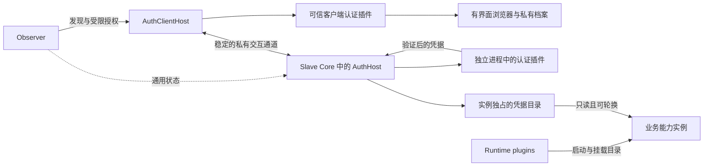

# 统一认证插件与凭据交付设计

日期：2026-11-03。状态：设计提案。关联：[Issue #9](https://github.com/yzs15/personal_computing_space/issues/9)。
遵循[仓库设计原则](../spec-design-guidance.md)。

## 1. 设计结论与扩展保证

认证插件与执行插件独立。新增认证协议通过安装认证插件完成，Observer 不枚举认证协议，runtime plugin 不处理登录、回调、凭据验证或续期。

在 Slave Core 中增加独立的 `AuthHost`，负责认证插件的加载和通用生命周期；将 `loom-auth` 重构为用户机器上的 `AuthClientHost`，提供统一门户、可信客户端插件和有界面浏览器。两个宿主通过稳定协议交互。业务能力包通过固定的凭据通道消费结果。

重构完成后，在宿主 ABI、凭据交付方式和业务包接受的凭据契约均满足要求的前提下，增加认证协议保证：

- Observer 不改代码、不重启、不修改实例配置。
- Slave Core、已有 runtime plugin 的代码和进程不变。
- 已运行的能力实例不重建，激活 URI、容器 ID、`activation_revision` 不变。
- 只安装新认证插件及必要的客户端插件，并配置对应的认证绑定。已有绑定不会自动切换插件版本。

这次重构需要一次基础设施和能力包适配。当前没有通用凭据通道、或只在启动时读取密钥的旧实例，不能承诺原地接入。后文的“实例不变”指已经满足新交付契约的实例。

本设计直接替换旧认证接口，不保留按旧 `interaction.mode` 回退的兼容层。历史不可变包及内容不改写；适配后的能力包发布新版本。

## 2. 当前耦合及其来源

现有认证流程通过 Observer → Slave → runtime plugin → 能力容器的私有 hook 执行：

| 位置 | 当前耦合 |
| --- | --- |
| [包契约](../../../loom_v2/contracts/package_contracts.py) | 在 `container:http` 的 body 中枚举认证方式及各方式的字段。 |
| [Observer BrowserAuth](../../../loom_v2/observer/browser_auth.py) | 持有浏览器会话，按方式判断会话创建和 `pending` 回调。 |
| [认证状态投影](../../../loom_v2/observer/authentication.py) | 理解 `cookie_name`、`storage_key` 等交互字段。 |
| [HTTP runtime](../../../runtime_plugins/container_http_v1/runtime.py) | 提供 `auth_start` / `auth_browser`，在 provision、inspect 中探测认证并解释结果。 |
| [Slave 生命周期](../../../loom_v2/slave/service.py) | 从 runtime 返回值取得认证状态，并与运行状态混合处理。 |
| [SDK 登录客户端](../../../loom_orchestration/auth.py) | 在核心流程中按认证方式分支，执行浏览器操作。 |

因此，仅在 Observer 中增加一个动态协议注册表还不能实现解耦。认证状态的来源、凭据交付和 runtime 生命周期也需要分离。

## 3. 组件与职责



| 组件 | 负责 | 不需要理解的内容 |
| --- | --- | --- |
| Observer | Loom 调用身份、资源发现、通用管理动作、受限授权、公开状态。 | Cookie、localStorage、OAuth、验证码或设备码的协议细节。 |
| Slave Core | 激活身份和 revision、凭据需求及绑定、执行入口校验、运行状态与认证状态的合成。 | 具体认证流程及供应商字段。 |
| AuthHost | 插件注册和监管、会话及绑定状态、凭据保存和交付、版本切换、检查与续期调度。 | 业务包按什么 runtime 运行。 |
| 服务端认证插件 | 供应商流程、身份验证、协议状态、实际凭据获取和刷新、验证结果及凭据产物。 | Docker、runtime RPC、实例重建。 |
| AuthClientHost | 用户门户、可信客户端插件加载、统一浏览器档案、有界面策略、会话通信。 | 某一种供应商认证的完整实现。 |
| 客户端认证插件 | 使用宿主提供的交互能力完成客户端部分，向对应服务端插件提交交互结果。 | Observer 或 runtime 的内部控制接口。 |
| Runtime plugin | 创建、检查、停止运行环境；按统一上下文交付凭据目录。 | 认证插件名称、登录步骤、`pending`、token 或证书的格式。 |
| 业务能力包 | 声明可接受的凭据契约，按该契约读取凭据并调用业务服务。 | 凭据来自手动配置、SSO、设备码还是其他认证协议。 |

AuthHost 是 Slave 公共基础设施，和 RuntimePluginHost 并列。它不通过某个 runtime plugin 启动，也不为每个 runtime 复制一份实现。可复用现有进程监管、Unix socket HTTP/JSON 和 `httpx`，将通用传输与监管部分抽出；不复用绑定了执行类型及认证 hook 的现有接口。

## 4. 三个需要分开的契约

### 4.1 认证插件 ABI

定义独立的 `loom.auth-plugin/1`。协议中只有通用操作，不枚举登录方式：

| 操作 | 语义 |
| --- | --- |
| `describe` | 返回插件不可变版本、配置 Schema 引用、可产出的凭据契约、所需客户端插件及宿主能力。 |
| `begin` | 根据绑定上下文开始认证，返回等待交互、已验证产物或明确失败。 |
| `advance` | 接收同一会话的插件消息，推进认证；等待中的会话可以多次调用。 |
| `maintain` | 检查当前凭据，必要时按供应商机制续期；需要人工交互时返回通用状态。 |
| `cancel` | 结束挑战及其私有协议状态，取消相关工作。 |

AuthHost 统一解释 `waiting`、`verified`、`auth_required`、`error` 等有限结果语义，负责会话有效期、序号、防重放和状态持久化。`pending` 不再根据 Cookie 或 storage 类型判定。

协议消息的私有正文由相应插件的 Schema 校验。Cookie 名、存储键、PKCE 或设备码结构都属于插件；Observer、Slave Core 和 runtime 不解析这些字段。插件的私有状态保存在 AuthHost 管理的独立状态目录，不放进 Observer 的公开状态或 `runtime_profile`。

客户端插件采用独立的稳定 ABI，接收会话上下文和受限交互能力。常见浏览器操作可以由随基础版本安装的客户端插件复用；新协议可以引用已有客户端插件，也可以独立安装新的客户端实现。SDK 核心不再维护 `METHODS` 列表。

一个认证插件发行物可以声明服务端组件和可选的客户端组件；客户端组件也可引用已安装的通用实现。供应商改动或新的交互代码通过这些组件发布，不为每个 runtime 提供另一套登录脚本。

认证插件有独立注册表，通过不可变插件引用选择，不参与 `(package_type, execution.kind, execution.version)` 的 runtime 选择。插件配置 Schema 由 AuthHost 查找和校验，Observer 只校验通用引用及授权边界，不为新插件加载协议专用的字段分支。

### 4.2 凭据契约

认证方式与凭据格式分别描述。例如 `cs101-bearer/v1` 约定原始 token 文件、适用受众、验证要求和读取规则，不包含 Cookie、localStorage 或 SSO 的名称。

契约是带不可变引用的声明数据，至少约定：

- 产物的文件布局、大小及权限要求。
- 受众和主体身份的含义，以及有效期、验证时间和轮换规则。
- 消费者需要的启动时机和运行中读取能力。

能力包在 runtime-neutral 的 `credential_requirements` 中声明 slot、可接受的契约引用，以及从自身实例配置解析的受众范围。这里不指定认证插件或登录方式。

举例：CS101 的 `upstream` slot 接受 `cs101-bearer/v1`，受众从实例配置的 API origin 取得。静态 token 插件与浏览器 SSO 插件可以产出同一契约，业务包无需区分来源。

AuthHost 校验插件产物的契约、受众、主体约束和当前绑定；不能仅凭文件名相同就接受。认证成功表示凭据已按声明验证，不保证用户拥有所有业务动作的权限，业务权限拒绝继续按原服务语义返回。

### 4.3 凭据交付 ABI

定义通用的 `credential-directory/1`：由 Core 为每个激活创建私有根目录，并在实例首次创建时交付。目录在未登录时也存在，内容可为空或只含状态。

Runtime plugin 只收到 Core 验证的目录句柄、只读访问要求和实例内位置。它不选择认证插件，不接收供应商参数，不解释凭据正文。容器 runtime 负责目录挂载，进程 runtime 负责把实例专属目录交给进程；这些适配各实现一次。

凭据不通过环境变量或启动命令传递，因为这类传递方式无法在既有进程中可靠轮换。消费者使用原生文件或公共的 `CredentialView` 读取接口。

三个契约分别版本化：认证插件 ABI、凭据格式契约、交付 ABI。新增认证协议不会自动要求升级另外两个契约。

## 5. 认证绑定与一次完整登录

### 5.1 绑定独立于运行配置

每个必需的 credential slot 有一个 `AuthBinding`，由 AuthHost 管理。记录至少包括：

- workspace、激活 URI、包引用和摘要、适用的 activation revision、slot 与受众。
- 凭据契约引用、认证插件的固定不可变版本、插件配置的私有引用。
- 独立的 `binding_revision`、已验证主体、当前凭据 generation 与公开认证摘要。

默认每个激活单独绑定和保存凭据。用户本地可以共享浏览器 SSO 档案，这不等于不同远端实例共享凭据目录。

`configure-auth` 接收非敏感配置及私有配置引用。client secret 等敏感材料由 operator 在 AuthHost 私有配置入口准备，不放入通用管理动作、实例配置或包内容。

插件配置及选择不放进 runtime 的 `instance_config`，也不参与容器运行配置摘要。更换认证插件更新 `binding_revision`，不会改变 `activation_revision`，不会触发 runtime configure 或 provision。

普通凭据刷新只增加 generation。同一绑定的主体默认固定；认证返回不同账号时，需要显式变更绑定及授权，不能在运行中的实例里静默换账号。

Core 为绑定集合维护独立的 `auth_revision`。业务访问授权和 CredentialView 租约同时绑定该修订，绑定切换后旧授权不能用于新身份；相同绑定内的正常续期不改变该修订。Observer 只传递通用修订信息，不理解认证插件。切换期间新的业务调用可以等待认证，但服务进程保持运行。

### 5.2 操作流程

1. 激活能力包，Core 创建 credential slot 及稳定目录。根据包的声明，可以先运行服务并阻止业务调用，也可以在启动必须依赖凭据时先等待认证。
2. 用户通过通用 `configure-auth` 管理动作选择已安装的认证插件及其配置。AuthHost 校验插件与 slot 契约、受众和宿主能力是否匹配。
3. `loom-auth` 通过 DESCRIBE 获得现有的 `auth-start` 管理入口。Observer 处理通用授权与版本检查，实际会话由 AuthHost 创建。
4. 返回绑定到用户、激活、slot、revision 和有效期的私有会话句柄，以及必要的客户端插件引用。客户端缺少可信插件时明确报缺失，不自动执行能力包或远端消息提供的代码。
5. 客户端插件与服务端插件通过 AuthHost 的稳定交互通道推进流程。需要浏览器时，由 AuthClientHost 打开有界面窗口并管理私有档案。
6. 服务端插件验证上游身份及凭据，返回符合 slot 契约的产物；AuthHost 再检查绑定是否仍有效，并原子发布新的 generation。
7. Core 合成认证和运行状态，恢复直接调用及等待中的 Run。认证成功不重建实例，不提交新业务 Run。
8. AuthHost 调度 `maintain` 进行重检或续期。业务代码发现某代凭据被拒绝时，可以通过公共 CredentialView 通道报告 generation；旧请求的失败不能撤销已经更新的新凭据。

Observer 保留一个通用认证入口即可，不再创建浏览器挑战、接收 `cookie_name` 或按具体方式处理回调。公开描述只包含通用状态及引用，交互细节由客户端向 AuthHost 获取。

认证管理通道不使用业务动作的 ready 门禁。激活尚在 `pending_auth`、尚未启动业务进程或处于可恢复故障时，只要用户授权、desired state 和 revision 有效，就可以开始认证；成功认证仍不能清除独立的运行故障。

## 6. 私有通道与凭据轮换

### 6.1 会话授权与路由

复用已有 GRIP 发现、受信 binding、目标受众和短期授权，不增加另一套调用身份。AuthHost 在节点公共数据入口之后提供固定地址和 audience，所有认证插件共用它，实际插件进程只监听私有 Unix socket。

新增插件不会增加需要 Observer 或已有 runtime 实例配置的新端口、路由或 audience。目录可以正常发布新增插件的描述数据，Observer 不需要重启或增加协议分支。

认证管理动作不成为记录输入输出的业务任务节点；私有交互使用仅供认证会话使用的字节流通道，复用现有流的大小、期限和授权约束。会话额外绑定 `binding_revision`、交互序号和一次性状态。

优先使用客户端到 AuthHost 的可信直连 binding。部署使用 Observer relay 时，只进行通用转发；凭据正文不进入公开描述、业务日志、Run 或 ContentStore。此处不宣称 relay 在传输中完全看不到字节。

### 6.2 实例内稳定交付

目录结构示意：

```text
/run/loom/credentials/<slot>/
  current -> generations/<generation>/
  generations/<generation>/
    metadata.json
    files/...
  agent.sock
```

AuthHost 写完整的新 generation，校验后原子切换 `current`。元数据和凭据在同一 generation 内，消费者可取得一次快照，避免混用不同代的证书和私钥。目录及文件使用契约要求的私有权限；业务实例只读，指针由 Host 管理。

`agent.sock` 是实例专属的通用本地通道，提供请求可用快照、报告某代凭据被拒绝等操作。它和文件一起通过同一个目录交付，不需要每种认证方式新增 runtime 接口。读取有效期的请求不能隐式打开浏览器，需要人工登录时返回通用的认证需求。

已有调用的快照在其受限租期内保留，过期后回收。已经发给上游的请求无法由本地凭据轮换撤回；执行层不自动重放可能产生副作用的业务动作。

停止实例撤销活动会话及访问授权，仍可保留私有凭据供原实例恢复时重新验证；显式退出或删除认证绑定时清除凭据。停止和清理动作不会被认证故障阻塞。

## 7. 状态归属与失败处理

Runtime plugin 只报告存在性、运行健康、身份和配置是否匹配。AuthHost 独立报告 `auth_required`、`authenticated`、`auth_failed`，不再把它们嵌入 runtime 的健康探测。

| 运行情况 | 认证情况 | Core 对外合成的状态 |
| --- | --- | --- |
| 运行健康 | 全部必需 slot 已认证 | 在其他服务入口条件满足时 ready。 |
| 运行健康 | 必需 slot 需要登录或缺少绑定 | pending_auth。 |
| 运行健康 | 验证、插件通信或续期失败 | degraded，并保留具体的通用原因。 |
| 运行故障 | 任意 | 按运行故障处理，认证成功不能掩盖它。 |
| 已停止 | 任意 | stopped，不接受新认证会话。 |

Core 在直接数据入口和任务执行入口都检查这些条件，并向 Observer 上报通用摘要。Driver Pool 继续根据激活状态等待和恢复，不解释认证协议。

插件崩溃不等于凭据已被上游撤销，也不删除最后保存的凭据。AuthHost 标记检查不可用、阻止把未验证结果当成新成功，并在插件恢复后重新验证；过期和验证新鲜度上限不能被无限延长。

新 `auth-start`、绑定切换、revision 变化和会话超时撤销旧挑战的发布权限。凭据即将发布时再检查会话、主体、受众和 revision，避免迟到回调覆盖新配置。平台只处理这些通用规则，HTTP 401、Cookie 轮换等具体含义由认证插件判断。

供应商步骤的幂等和不可恢复状态由插件处理。恢复本地会话记录不表示可以重放一次性 OAuth 交换；插件可以明确要求重开挑战，通用宿主无需理解具体协议。

## 8. 插件安装和有界面客户端

认证插件由 operator 安装，沿用现有 runtime plugin 的受信任安装模型。普通能力包和 agent 只能引用已安装插件，不能在 manifest 或交互消息中提供命令、脚本或可执行文件地址。

AuthHost 支持显式热注册：验证 bundle、ABI 和描述符，启动新插件版本并通过自检后再加入注册表。失败安装不影响已有绑定。插件版本并存，活跃会话固定使用开始时的版本；卸载前检查引用，不强制迁移会话。

现有 RuntimePluginHost 主要在启动时发现插件，因此这里只复用其传输和监管基础代码，不把“安装认证插件”实现为重启 Slave、重新扫描并重启所有 runtime plugin。

AuthClientHost 也支持可信客户端插件热注册，共用一个门户和 BrowserManager。新交互不能通过远端返回脚本让门户临时执行；缺少客户端插件或宿主能力时，在开始登录前明确报告。

有界面浏览器策略由 BrowserManager 强制执行，插件不能请求无头回退。手动登录和自动复用均使用宿主管理的有界面窗口；用户凭据、Cookie 和站点存储保留在私有档案中。

浏览器档案、窗口互斥、origin 限制、Cookie 和存储读取授权属于共同宿主能力，协议插件不重复管理。具体读取哪些数据由可信客户端插件及配置声明，采集结果只能进入该认证会话。

CS101 的 IAAA 限制作为该绑定的访问策略：IAAA 登录流量仅允许经有界面浏览器发生，服务端插件不请求 IAAA；验证得到的 CS101 token 时只访问配置的 CS101 origin。本设计工作不触发真实 IAAA 登录。

## 9. 新协议对已有实例的影响

| 变化 | 所需动作 | Observer / runtime / 既有实例 |
| --- | --- | --- |
| 新 SSO 方式仍产出已接受的 Bearer token | 安装认证插件，必要时安装客户端插件；建立或切换绑定。 | 不升级、不重启、不重建。 |
| 某供应商流程变化，凭据契约不变 | 发布新认证插件版本，显式切换对应绑定。 | 不升级、不重启；旧会话继续使用固定版本。 |
| 改用不同的凭据格式，业务包尚不支持 | 适配消费者并发布新能力包版本。 | runtime 通道兼容时不改；能力实例可能需要升级。 |
| 引入现有宿主无法表达的硬件或交付能力 | 升级相应宿主或交付 ABI，并重新做能力协商。 | 不承诺所有旧环境无需变化。 |

例如，CS101 已声明接受 `cs101-bearer/v1` 并按请求读取凭据：从静态 token 改成浏览器 SSO，变化的是生成 token 的认证绑定，业务镜像、实例配置、运行挂载和 activation revision 都不变。

安装插件不会主动给已有实例切换账号或认证来源。是否选用新插件是独立的显式管理动作，observer/runtime 的既有进程不参与插件替换。

## 10. 一次性重构与旧实现处理

实现顺序以独立契约为边界：

1. 提取公共插件进程监管与 Unix socket 传输；实现 AuthHost 注册表、会话、绑定和凭据目录。
2. 在 runtime-neutral 包模型中增加 credential requirements；在 Core 增加绑定管理、目录准备、执行检查和状态合成。
3. runtime plugin 一次支持固定的凭据目录交付。删除其认证 RPC、私有 hook 转发、认证探测及状态解释。
4. 将 Observer 的认证入口改为通用授权、发现和路由；删除具体方式、浏览器会话状态机和特定字段投影。
5. 将 loom-auth 改为客户端插件宿主；迁移静态 profile、浏览器 Cookie、站点存储、redirect 和设备码实现，保留统一的有界面浏览器及档案管理。
6. 将能力网关中的供应商认证逻辑提取为认证插件；网关只消费凭据。按需适配运行中读取，并发布新的不可变能力包版本。

明确替换的旧代码包括 `BrowserAuth` 的协议分支、`RuntimePlugin.auth_start/auth_browser`、HTTP runtime 的认证 hook、`body.authentication.interaction` 枚举、SDK 的认证方式枚举以及能力包的相应旧 hook。不为这些旧路径增加新的认证类型。

此次初始迁移需要适配包和具备新 ABI 的基础版本。没有预留凭据目录的实例需在本次迁移时重建；此后安装新认证协议不会再次造成该类重建。

## 11. 验收标准

架构的核心验收不是“插件成功登录一次”，而是验证新增协议只影响它自身的安装和绑定：

1. 启动 Observer、Core、HTTP runtime、另一种服务 runtime 及运行中的能力实例，记录进程、容器和 activation revision。
2. 运行期间安装一个这些组件构建时均不存在的认证插件，以及必要的客户端插件；不修改或重启上述组件。
3. 给已声明兼容凭据契约的实例切换绑定并完成登录；确认 URI、容器 ID、挂载、运行配置摘要和 activation revision 均未变化，也未调用 runtime 的重新 provision。
4. 同一个认证插件为两种 runtime 的消费者提供凭据，认证实现及通用测试无需复制；交付 ABI 不支持的 runtime 在预检时明确失败。
5. 覆盖手动登录、有界面自动复用、空候选值、无效凭据、等待交互、续期、网络失败、取消和同实例重新认证。
6. 覆盖旧回调、旧绑定 revision、旧 generation 拒绝报告、停止后回调及身份/受众不匹配；所有路径均不能发布错误凭据。
7. 验证插件热注册失败、插件崩溃及宿主恢复不影响不相关的 runtime 或认证绑定；Observer 重启不会丢失 AuthHost 持有的认证会话状态。
8. 缺少客户端插件或 GUI 时明确失败，不退回无头浏览器；现有浏览器档案、其他 origin 和不相关存储保持隔离。
9. 验证公开描述、日志、Run、ContentStore 及跨实例目录中没有凭据；真实供应商登录另行按授权验证。

Issue #9 的设计完成条件是确定上述职责和契约；关闭 issue 还需要实现及通过这些跨 runtime、不中断实例的扩展验收。
